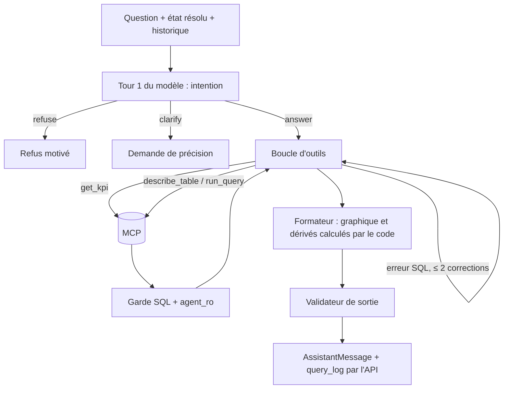

# Agentic System Design

Version 3 (après relecture croisée). Complète [SRS.md](../SRS.md) §8-9 et [SYSTEM_DESIGN.md](SYSTEM_DESIGN.md).

Principe directeur : **un seul agent, des outils contraints, des garde-fous déterministes autour d'un modèle probabiliste.**

## 1. Choix d'architecture agentique

| Question | Décision | Raison |
|---|---|---|
| Un agent ou plusieurs ? | Un seul (A1) | Schéma de 5 tables ; un routeur ou un critique ajoute coût et latence sans gain prouvé. À réévaluer selon les erreurs de l'évaluation. |
| Boucle | Appel d'outils itératif borné à 6 étapes et 30 s | Suffisant pour question → SQL → résultat |
| RAG | Non (A2) | La couche sémantique tient dans le contexte |
| Cache SQL | **Non** (A8) | Mauvais contexte en suivi de conversation ; masquerait la variance mesurée |
| Mémoire | 6 derniers échanges + **état résolu** | RF5 sans croissance du contexte |
| Auto-vérification | Garde-fous déterministes, pas de second LLM (A4) | Reproductible, peu coûteux |

## 2. Vue d'ensemble



## 3. Intention (RF14, Must)

La décision répondre / préciser / refuser est le **premier tour de la même boucle** (une sortie structurée, ou des outils `clarify` et `refuse`), pas un appel LLM supplémentaire.

```
intent: "answer" | "clarify" | "refuse"
missing: ["période" | "périmètre" | "kpi" | "région client ou agent" ...]
reason: str
```

- **clarify** : période, KPI, périmètre ou sens de « région » manquants et non déductibles de l'état résolu. Une seule question, avec 2-3 choix.
- **refuse** : hors du modèle de données, demande de modification, ou tentative de contourner les règles.
- Valeurs par défaut documentées et rappelées dans la réponse (ex. « ce mois-ci » = mois de `REFERENCE_DATE`).
- Évaluée isolément : matrice de confusion answer / clarify / refuse sur ≥ 30 cas de dev, faux refus ≤ 5 %. Si un modèle plus petit est envisagé pour ce tour, il est comparé avant adoption.

## 4. Couche sémantique (`agent/semantic/`, versionnée)

| Fichier | Contenu |
|---|---|
| `tables.yaml` | Tables et colonnes, types, valeurs possibles |
| `kpis.yaml` | **Source unique des KPI** : nom, définition, SQL canonique paramétré, paramètres autorisés (énumérations). Le tableau du SRS en est dérivé |
| `glossary.yaml` | « région » (client ou agent), « agent actif » ≠ `statut_agent`, « aujourd'hui » = `REFERENCE_DATE` |
| `examples.yaml` | ~20 couples question → SQL, exclus du jeu de test |

Une version (hash) de la couche sémantique est enregistrée dans chaque trace. Un contrôle (`make eval`) échoue si un SQL normalisé (sqlglot) ou un squelette de requête est commun à `examples.yaml` et `eval/test.yaml`, sauf déclaration explicite ; le fichier de test est figé par hash avant P1.

## 5. Outils

| Outil | Usage |
|---|---|
| `get_kpi` | **Chemin principal** si la question correspond à un KPI : SQL validé, paramètres liés, pas de génération |
| `describe_table` | Colonne ou valeur incertaine |
| `run_query` | Classements, découpages hors KPI ; passe par le garde SQL |
| `list_tables` | Rarement : le schéma est déjà dans le contexte |

Retours d'outils : `(lignes, durée, truncated)`. Si `truncated`, l'agent ne cite aucun total calculé sur des lignes tronquées et le dit dans la réponse.

## 6. Garde-fous

| Niveau | Contrôle |
|---|---|
| Entrée | Longueur maximale ; quota par utilisateur. La détection de consignes n'est qu'une défense secondaire, non comptée comme contrôle |
| Outils | Garde SQL par liste blanche, rôle `agent_ro`, `EXPLAIN` borné (SYSTEM_DESIGN §6) |
| Boucle | 6 étapes, 2 corrections SQL, budget de jetons et 30 s par question |
| Données non fiables | Résultats passés en JSON typé, encadrés et marqués « données non fiables » ; textes libres exclus ou tronqués ; l'agent n'a aucun outil d'écriture ni de gestion de droits |
| Sortie | Validateur : tout chiffre cité provient des résultats ou d'un **dérivé calculé par le code** (écart, pourcentage de variation) ; période et périmètre présents ; graphique cohérent ; `sql` absent si rôle décideur |
| Résultat vide | « Aucune donnée pour ... », jamais un zéro inventé |

Les comparaisons de périodes sont calculées en SQL ou par du code déterministe puis ajoutées à l'ensemble vérifiable : le validateur n'interdit donc pas les écarts ni les pourcentages.

## 7. Sortie structurée

`AssistantMessage` (SYSTEM_DESIGN §5), validé par Pydantic. Échec de validation : un nouvel essai, puis réponse de repli honnête. Le **graphique est calculé par le formateur** à partir de la forme du résultat, jamais produit par le modèle :

| Forme du résultat | Graphique |
|---|---|
| colonne temporelle + une mesure | courbe |
| une catégorie + une mesure, ≤ 12 valeurs | barres |
| parts d'un tout, ≤ 6 valeurs | répartition |
| une seule valeur | chiffre clé |

## 8. Conversation et suivi (RF5)

Contrat : `resolved_state {kpi, période, périmètre, filtres}` est inclus dans `AssistantMessage` et stocké dans `message.structured_json`. L'API renvoie à l'agent l'état du dernier message plus 6 échanges. Une question de suivi modifie uniquement le champ concerné (« Et pour le mois précédent ? » → période).

## 9. Évaluation (conçue avant l'agent)

| Élément | Détail |
|---|---|
| Jeux | `eval/dev.yaml` (~30), `eval/test.yaml` (40) ; catégorie, SQL de référence, piège couvert. Détail en SRS §11 |
| Exécuteur | `make eval` appelle le module agent directement, **cache absent**, même état de données et même `REFERENCE_DATE` ; références recalculées depuis les données seedées |
| Passes | 3 par question ; score = moyenne (min/max affichés) ; cohérence 3/3, 2/3, 1/3 ; les questions KPI exigent 3/3 |
| Comparateur | `eval/compare.py` (testé) : résultat exécuté **et** chiffre cité = référence, période et périmètre corrects ; entiers exacts, ratios en tolérance relative 10⁻⁴, ordre des classements, résultat vide attendu |
| Statistique | Intervalle de Wilson 95 % ; agrégation dev + test pour le rapport final ; comptes bruts par catégorie, pas de conclusion sur une catégorie de moins de 8 questions |
| Ablations | (a) modèle seul + schéma brut ; (b) sans exemples ; (c) sans `get_kpi` ; (d) sans validateur de sortie. Delta rapporté avec intervalle |
| Traçabilité | Modèle (identifiant daté), température, hash des prompts, de la couche sémantique et des exemples, SHA git, graine et hash des données, `REFERENCE_DATE`, versions dbt et Postgres |
| Métriques | Voir SRS §11 : justesse, cohérence, matrice d'intention, taux de repli, rejets du validateur, usage de `get_kpi`, erreurs période/périmètre, étapes, latence par étape, jetons et coût |
| Anti-sur-ajustement | Itérations sur dev uniquement ; une exécution de test par jalon, journalisée ; les échecs du test ne sont analysés que par catégorie |

Une passe « cache chaud » n'existe plus (pas de cache) : la latence se mesure sur les 120 exécutions (40 × 3), en publiant p50, p90 et max (le p90 sur 40 questions repose sur peu d'observations).

## 10. Modes de défaillance

| Défaillance | Détection | Réponse |
|---|---|---|
| SQL erroné syntaxiquement | Erreur Postgres normalisée | Correction, 2 essais max |
| SQL valide mais faux | Jeu de test, SQL visible à l'analyste | Exemples ciblés, règle de glossaire |
| Mauvaise région (client/agent) | Pièges dédiés | Glossaire + précision dans la réponse |
| Chiffre inventé | Validateur de sortie | Rejet, nouvel essai, repli |
| Boucle sans fin | Compteur d'étapes, budget 30 s | Arrêt, repli honnête |
| Données malveillantes dans un résultat | Données encadrées, aucun outil d'écriture, rendu assaini | Impact limité à une réponse fausse, détectée par le validateur |
| Résultat tronqué cité comme total | Drapeau `truncated` | Interdiction de citer un total, mention dans la réponse |
| Dépassement coût ou latence | Budgets, timeouts | Interruption et message clair |
| LLM indisponible | Erreur réseau | Un nouvel essai, puis erreur explicite |

## 11. Coût et latence

Budget : médiane < 15 s, p90 < 30 s, bout en bout. Leviers : préfixe de prompt stable (mise en cache du préfixe côté fournisseur), `get_kpi` sans génération SQL, événements d'étape pour la latence perçue. Les jetons mis en cache sont comptés à part. Un budget de coût par question est fixé après la première mesure ; le coût est enregistré par étape dans `query_log`.

## 12. Observabilité

Un `trace_id` par question, un enregistrement `query_log` par appel d'outil (`step`, `attempt`). Les traces servent à l'analyse d'échecs, à la décomposition de la latence et à la vue d'audit (RF13).

## 13. Évolutions possibles (hors périmètre)

Second avis ou critique seulement si la justesse plafonne sous O1 pour des erreurs de raisonnement ; récupération sémantique si le schéma dépasse le contexte ; mémoire long terme : non prévue.

## 14. Décisions (ADR)

| N° | Décision | Raison | Écarté |
|---|---|---|---|
| A1 | Agent unique à boucle d'outils | Simplicité, latence | Multi-agents |
| A2 | Pas de RAG | Contexte suffisant | Index vectoriel |
| A3 | `get_kpi` d'abord (Must P1) | Chemin déterministe pour les chiffres critiques | Tout en SQL généré |
| A4 | Garde-fous déterministes | Reproductible, bon marché | LLM juge |
| A5 | Intention = premier tour de la boucle | Pas d'appel LLM supplémentaire, RF14 mesurable | Étape LLM séparée |
| A6 | État résolu dans `AssistantMessage` | Suivi fiable, rejouable | Historique brut seul |
| A7 | Évaluation écrite avant l'agent | Mesure objective | Évaluation finale seulement |
| A8 | Pas de cache SQL | Contexte de suivi, variance visible | Cache par question |
| A9 | Graphique et dérivés calculés par le code | Déterminisme, validation possible | Sortie libre du modèle |
