# Diagrammes

Version 5. Générés depuis `docs/diagrams/*.mmd` (Mermaid) ; rendus `svg/` et `png/` **régénérés le 2026-10-24** à partir des sources v5. Sources : [SRS.md](../SRS.md), [SYSTEM_DESIGN.md](SYSTEM_DESIGN.md), [AGENTIC_DESIGN.md](AGENTIC_DESIGN.md). Les blocs ci-dessous sont des copies des fichiers `.mmd`, qui font foi.

Régénérer (Chromium local) :

```
export PUPPETEER_EXECUTABLE_PATH=/chemin/vers/chrome
npx -y @mermaid-js/mermaid-cli -p puppeteer.json -i docs/diagrams/NN-nom.mmd -o docs/diagrams/svg/NN-nom.svg
npx -y @mermaid-js/mermaid-cli -p puppeteer.json -i docs/diagrams/NN-nom.mmd -o docs/diagrams/png/NN-nom.png -s 2 -b white
```

`puppeteer.json` : `{"args": ["--no-sandbox", "--disable-gpu"]}` dans un conteneur.

| N° | Fichier | Changement v4 → v5 |
|---|---|---|
| 1 | `01-architecture` | Proxy Caddy, bases `warehouse` et `keycloak`, analyse en workflow, MCP seul détenteur de `agent_ro` |
| 2 | `02-acteurs-droits` | Back-office MVP en lecture, console Keycloak, PR Git |
| 3 | `03-modele-etoile` | Valeurs ASCII précisées, membre « Non applicable » |
| 4 | `04-tables-applicatives` | `change_request` retirée ; champs LLM de `query_log` ; états de `feedback` ; `eval_run` en pass^3 |
| 5 | `05-sequence-question` | Claude explicite, outils v5, outils terminaux, SSE |
| 6 | `06-sequence-authentification` | MFA conditionnelle, force brute, Audience, session SSO |
| 7 | `07-agent-boucle` | Boucle v5 (outils terminaux, faits, validateur, gabarit) |
| 8 | `08-garde-sql` | Garde renforcé |
| 9 | `09-analyse-tableau-de-bord` | Workflow sans outil, routes `/api/dashboard` |
| 10 | `10-changement-configuration-pr` | **Remplace** `10-demande-de-changement` |
| 11 | `11-signalement` | 3 états |
| 12 | `12-evaluation` | Jeux v5, pass^3, McNemar, banc HTTP |
| 13 | `13-deploiement` | Proxy, Mailpit, `make migrate`, `make bench` |

## 1. Architecture d'ensemble

SPA derrière un proxy Caddy de même origine ; le sous-processus MCP est le seul détenteur du DSN `agent_ro`. Voir [SYSTEM_DESIGN §2](SYSTEM_DESIGN.md#2-vue-densemble-et-composants).

Rendu : [svg](diagrams/svg/01-architecture.svg) · [png](diagrams/png/01-architecture.png)

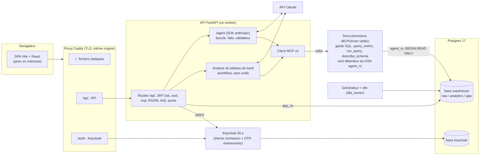

## 2. Acteurs et droits (MVP)

Back-office en lecture ; utilisateurs dans la console Keycloak ; configuration par PR Git. Voir [SRS §3](../SRS.md#3-acteurs-et-rôles).

Rendu : [svg](diagrams/svg/02-acteurs-droits.svg) · [png](diagrams/png/02-acteurs-droits.png)

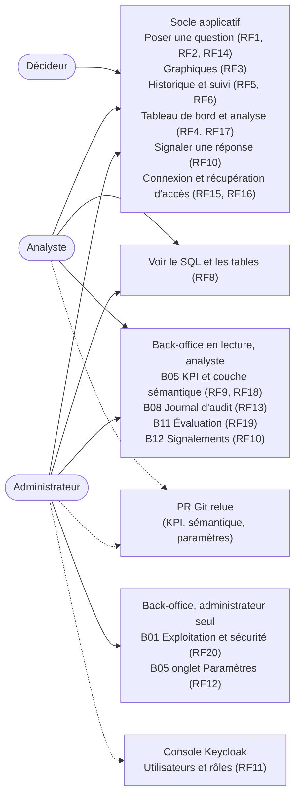

## 3. Modèle analytique en étoile

Valeurs codées en ASCII ; membres −1 « Hors agent » et « Non applicable ». Voir [SRS §7](../SRS.md#7-modèle-de-données).

Rendu : [svg](diagrams/svg/03-modele-etoile.svg) · [png](diagrams/png/03-modele-etoile.png)

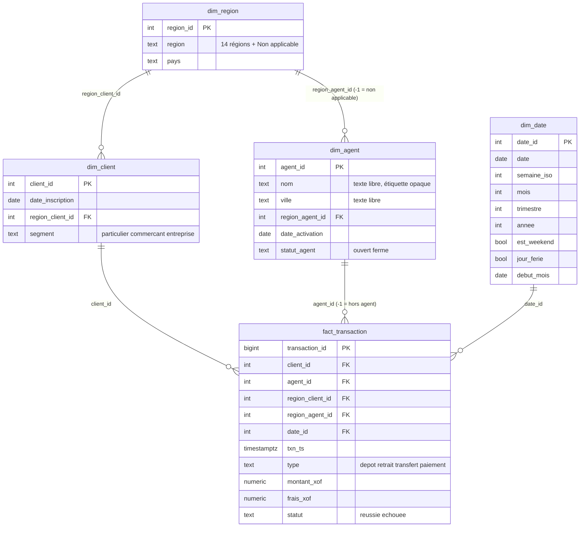

## 4. Tables applicatives

Huit tables du schéma `app` (plus de `change_request`), colonnes principales seulement. Liste complète et droits de `app_rw` : [SYSTEM_DESIGN §3](SYSTEM_DESIGN.md#3-base-de-données).

Rendu : [svg](diagrams/svg/04-tables-applicatives.svg) · [png](diagrams/png/04-tables-applicatives.png)

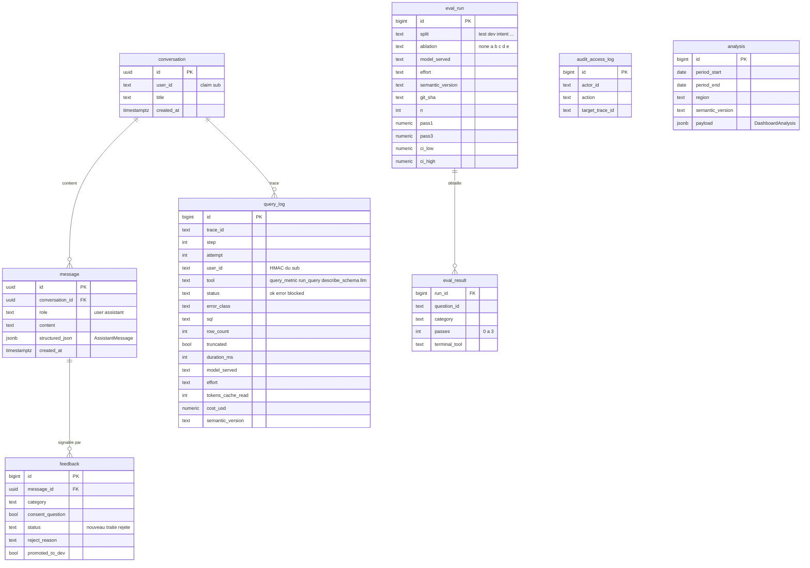

## 5. Flux d'une question

POST + SSE ; outils de données puis un outil terminal ; l'API écrit `query_log`. Voir [SYSTEM_DESIGN §4](SYSTEM_DESIGN.md#4-flux-dune-question).

Rendu : [svg](diagrams/svg/05-sequence-question.svg) · [png](diagrams/png/05-sequence-question.png)

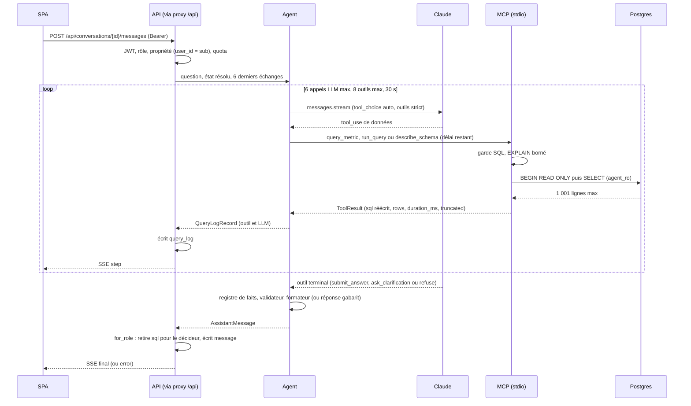

## 6. Authentification (OIDC + PKCE)

MFA pour analyste et admin seulement ; Audience mapper ; avertissement sur la session SSO, pas sur le jeton. Voir [SYSTEM_DESIGN §6](SYSTEM_DESIGN.md#6-sécurité-en-profondeur).

Rendu : [svg](diagrams/svg/06-sequence-authentification.svg) · [png](diagrams/png/06-sequence-authentification.png)

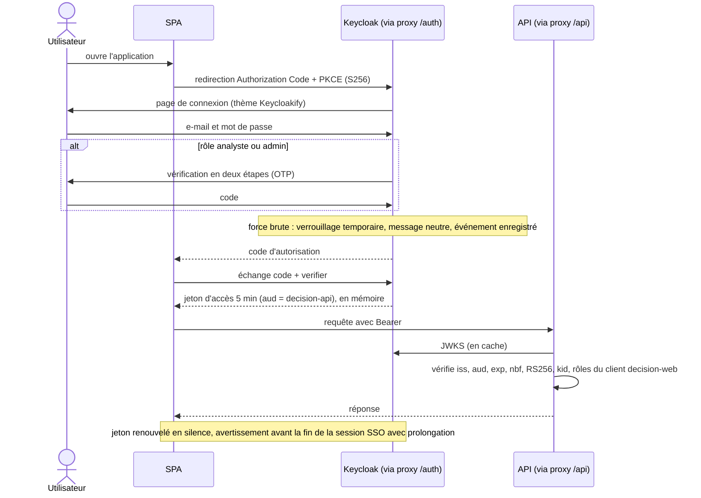

## 7. Boucle de l'agent (v5)

Plus de tour d'intention forcé : trois outils terminaux possibles à tout tour, citation par référence, validateur, réponse gabarit. Voir [AGENTIC_DESIGN §2-§7](AGENTIC_DESIGN.md#2-vue-densemble).

Rendu : [svg](diagrams/svg/07-agent-boucle.svg) · [png](diagrams/png/07-agent-boucle.png)

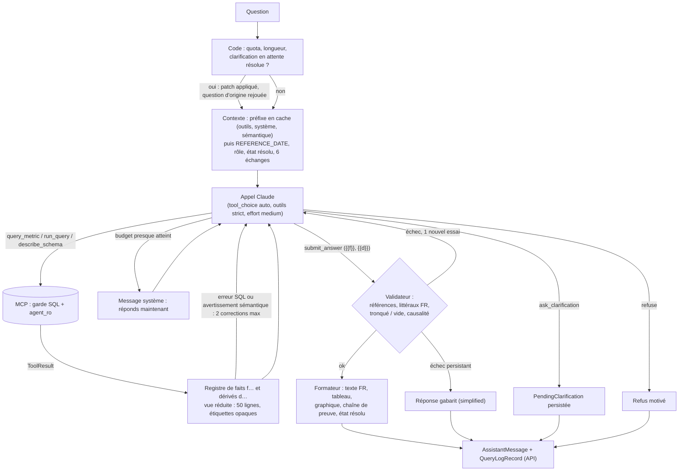

## 8. Garde SQL

Bornes avant analyse, liste blanche des types de nœuds, noms de fonctions normalisés, portée extraite de l'AST, `BEGIN READ ONLY`. Voir [SYSTEM_DESIGN §6](SYSTEM_DESIGN.md#garde-sql-liste-blanche-serveur-mcp).

Rendu : [svg](diagrams/svg/08-garde-sql.svg) · [png](diagrams/png/08-garde-sql.png)

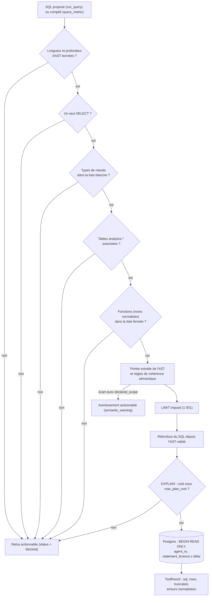

## 9. Analyse du tableau de bord (RF17, en workflow)

Le code récupère les KPI et calcule les candidats ; un seul appel LLM sans outil les rédige. Voir [AGENTIC_DESIGN §9](AGENTIC_DESIGN.md#9-mode-analyse-du-tableau-de-bord-rf17-en-workflow).

Rendu : [svg](diagrams/svg/09-analyse-tableau-de-bord.svg) · [png](diagrams/png/09-analyse-tableau-de-bord.png)

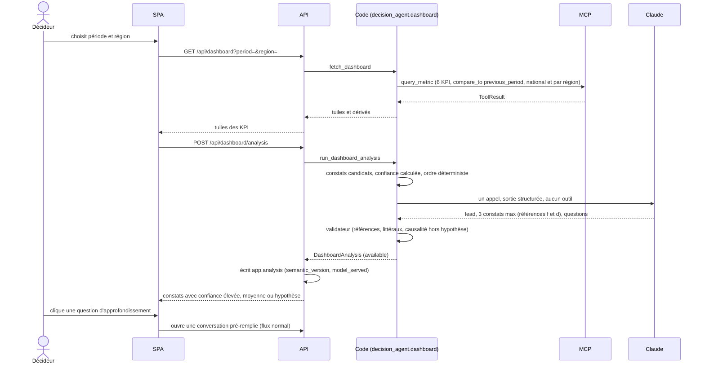

## 10. Changement de configuration par PR Git

Remplace la demande de changement v4 (`change_request` et commit par l'API). Voir [SRS ENF11](../SRS.md#5-exigences-non-fonctionnelles) et [SYSTEM_DESIGN S11](SYSTEM_DESIGN.md#10-décisions-adr).

Rendu : [svg](diagrams/svg/10-changement-configuration-pr.svg) · [png](diagrams/png/10-changement-configuration-pr.png)

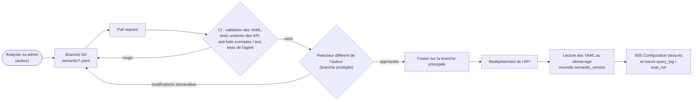

## 11. Signalement (états réduits)

Trois états ; la promotion vers le dev est une option du traitement. Voir [AGENTIC_DESIGN §12](AGENTIC_DESIGN.md#12-retours-des-utilisateurs).

Rendu : [svg](diagrams/svg/11-signalement.svg) · [png](diagrams/png/11-signalement.png)

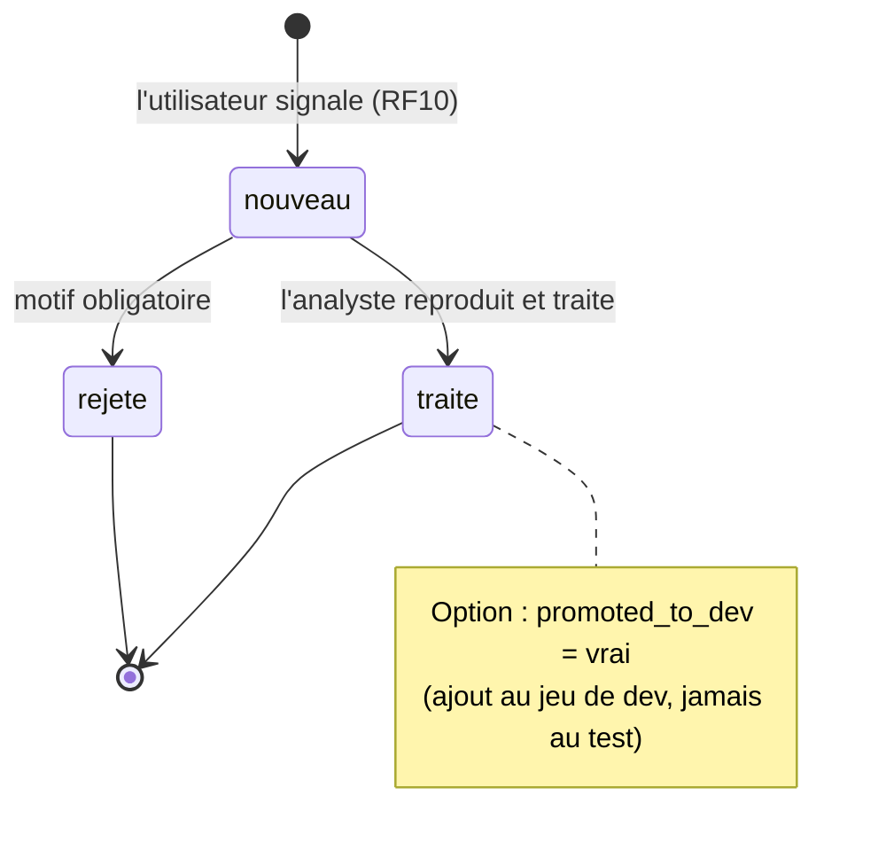

## 12. Pipeline d'évaluation (v5)

Test seul pour O1, pass^3 de référence, ablations (a)-(e), banc HTTP pour O2. Voir [SRS §11](../SRS.md#11-évaluation-et-critères-dacceptation).

Rendu : [svg](diagrams/svg/12-evaluation.svg) · [png](diagrams/png/12-evaluation.png)

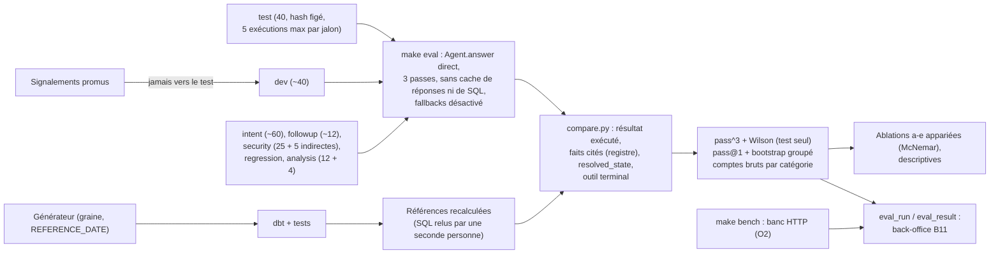

## 13. Déploiement (compose)

Le navigateur ne parle qu'au proxy ; `make eval` appelle l'agent directement. Voir [SYSTEM_DESIGN §7](SYSTEM_DESIGN.md#7-déploiement).

Rendu : [svg](diagrams/svg/13-deploiement.svg) · [png](diagrams/png/13-deploiement.png)

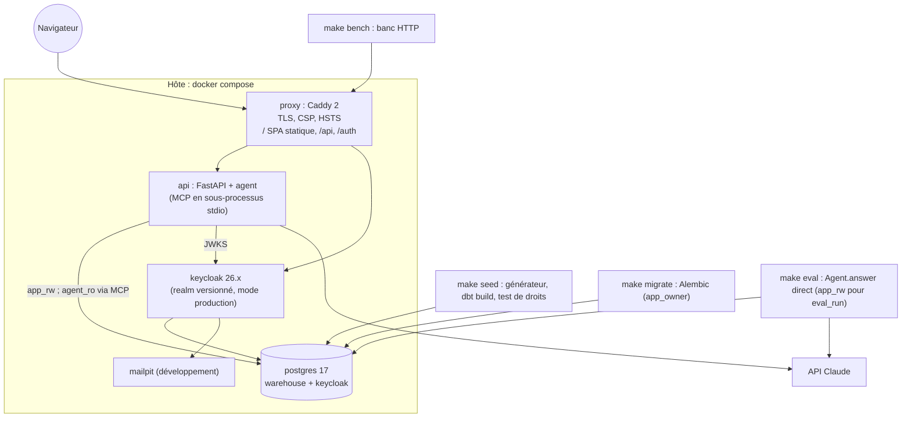
