# Diagrammes

Générés depuis `docs/diagrams/*.mmd` (Mermaid). Les rendus `svg/` et `png/` sont dans le même dossier. Sources : [SRS.md](../SRS.md), [SYSTEM_DESIGN.md](SYSTEM_DESIGN.md), [AGENTIC_DESIGN.md](AGENTIC_DESIGN.md).

Régénérer : `npx @mermaid-js/mermaid-cli -i docs/diagrams/NN-nom.mmd -o docs/diagrams/svg/NN-nom.svg`.

## 1. Architecture d'ensemble

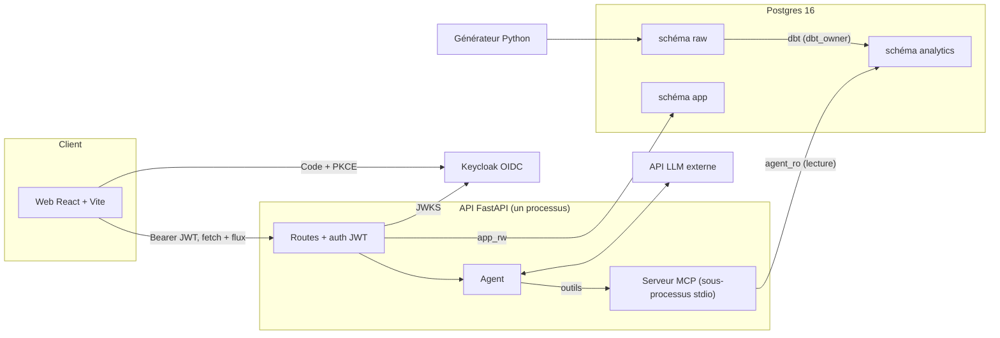

## 2. Acteurs et droits

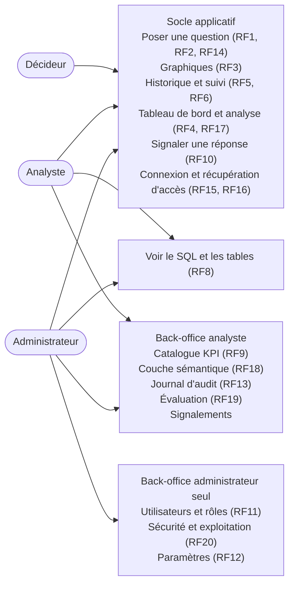

## 3. Modèle analytique en étoile

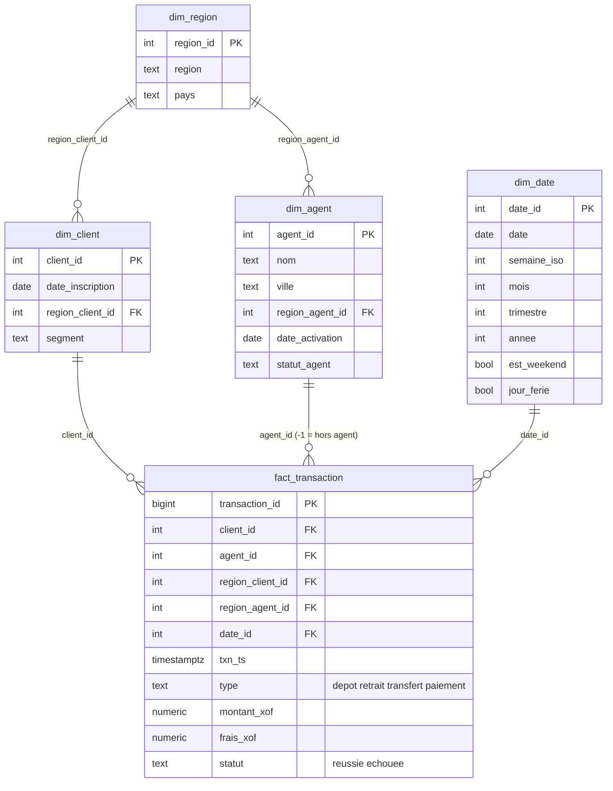

## 4. Tables applicatives

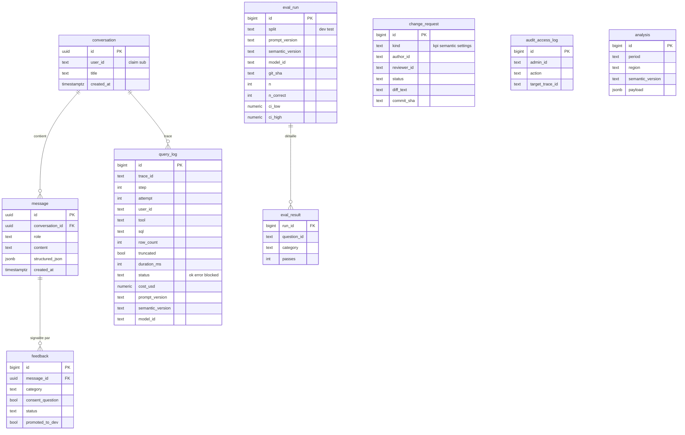

## 5. Flux d'une question

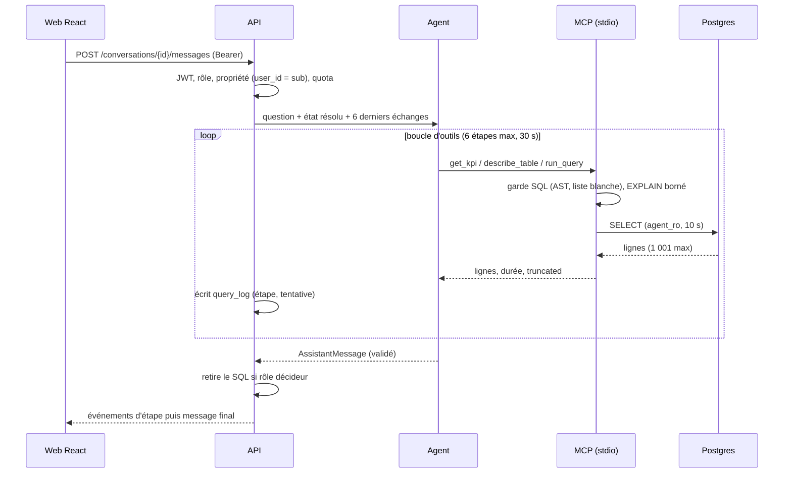

## 6. Authentification (OIDC + PKCE)

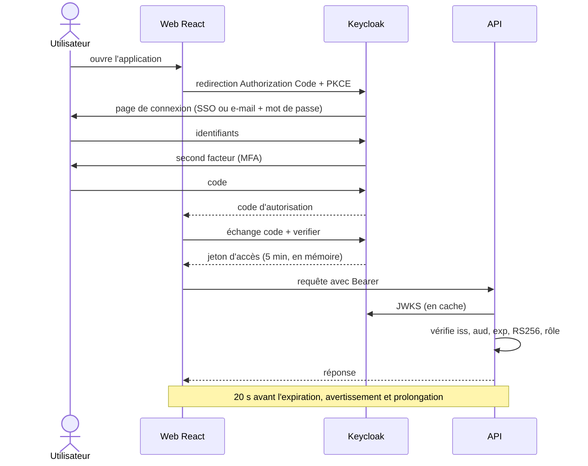

## 7. Boucle de l'agent

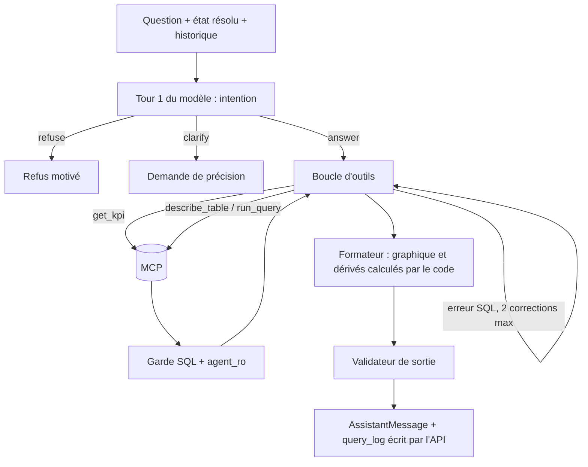

## 8. Garde SQL

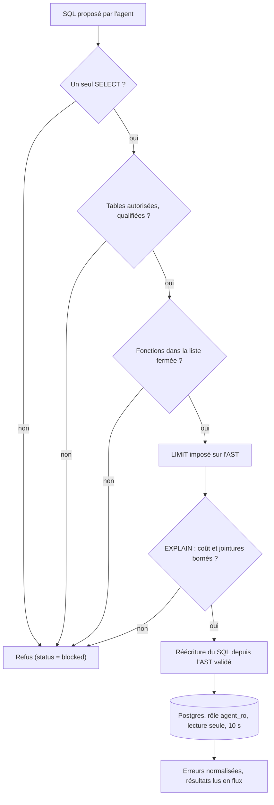

## 9. Analyse du tableau de bord (RF17)

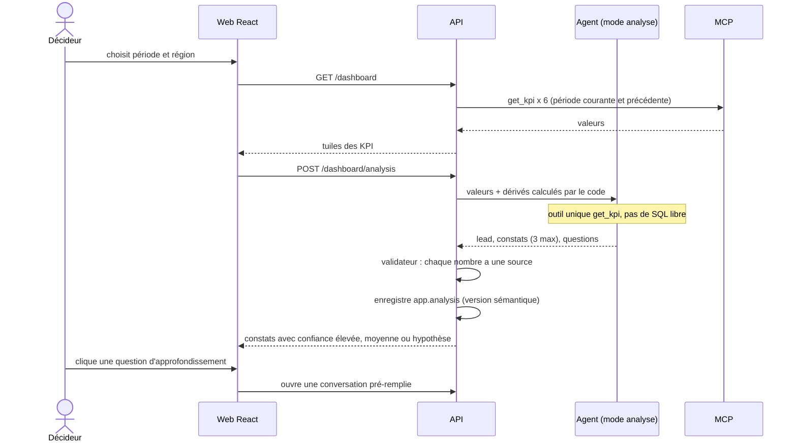

## 10. Demande de changement (états)

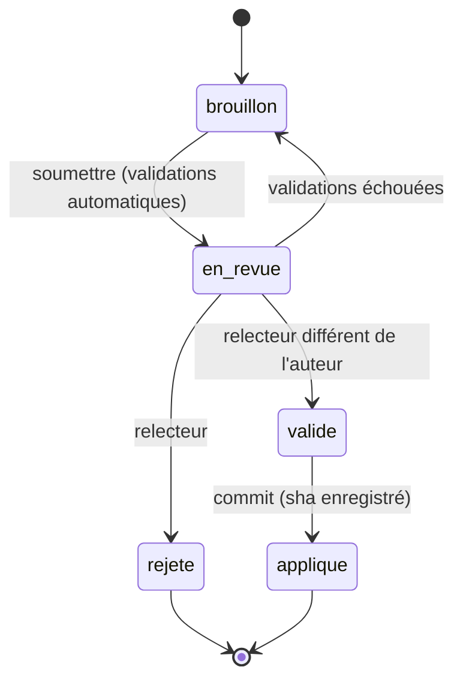

## 11. Signalement (états)

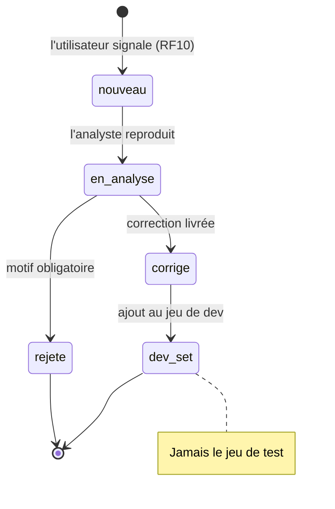

## 12. Pipeline d'évaluation

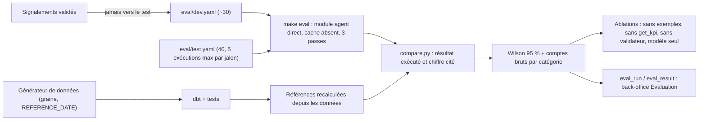

## 13. Déploiement

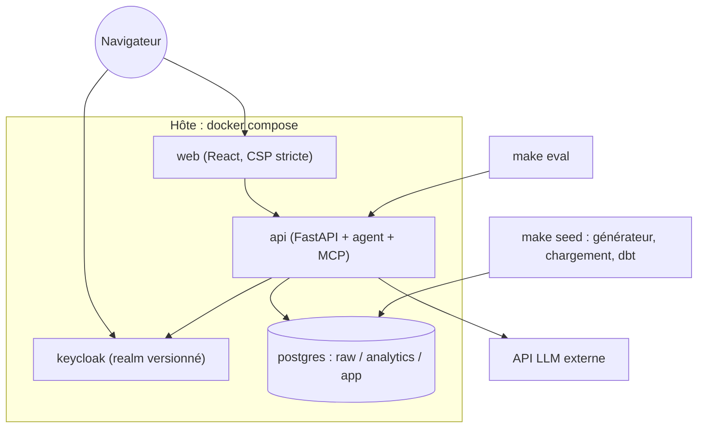
