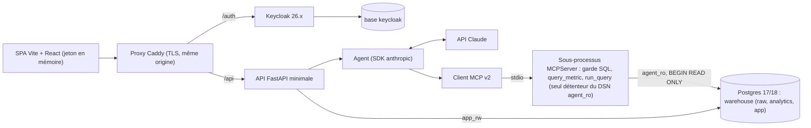

# Évaluation du projet et proposition v5

Date : 2026-10-24. Synthèse de trois revues indépendantes (system design, intégration LLM Claude, agentic design), chacune appuyée sur une recherche web. Les rapports complets, avec leurs sources, sont dans [docs/reviews/](reviews/) :

- [2026-10-24-system-design.md](reviews/2026-10-24-system-design.md) : 29 incohérences relevées (avec fichier:ligne), squelettes, état de l'art, charge, design révisé.
- [2026-10-24-llm-claude.md](reviews/2026-10-24-llm-claude.md) : modèles, prix, cache, coûts et latence chiffrés, design de la requête, journalisation.
- [2026-10-24-agentic-design.md](reviews/2026-10-24-agentic-design.md) : critique, boucle en pseudo-code, schémas d'outils, validateur, plan d'évaluation.

Ce document ne modifie ni le SRS ni les autres documents : il liste les décisions à prendre avant de les passer en v5.

## 1. Verdict

**Le cœur est solide.** L'état de l'art 2025-2026 confirme les principes du projet :
- agent unique avec des garde-fous déterministes ;
- étoile dbt ;
- MCP en lecture seule ;
- garde SQL par liste blanche sur l'AST, avec réécriture ;
- chemin certifié pour les KPI ;
- pas de RAG ;
- graphique calculé par le code ;
- évaluation écrite avant l'agent.

En revanche, trois choses sont à corriger avant de coder :

1. **Deux exigences ne passent plus avec l'API Claude actuelle.**
   - La température 0 (ENF2) n'est plus possible, ce qui est vérifié dans la [documentation de migration](https://platform.claude.com/docs/en/api/migration-2026-10-21) : depuis la version d'API `2026-10-21`, `temperature`, `top_p` et `top_k` renvoient une 400, même à leur valeur par défaut.
   - L'intention forcée par `tool_choice` (A5) est aussi touchée : les deux revues rapportent qu'un choix d'outil forcé renvoie une 400 sur Opus 5.5 et Sonnet 5.5. Ce point est à confirmer par un appel test en P1.
2. **L'enveloppe est trop large pour un mémoire.** La v4 représente environ 110-155 jours-personne hors rédaction. Le back-office en écriture, le thème Keycloak complet et les 45 écrans relèvent de la plomberie et ne servent pas la question de recherche.
3. **Les deux squelettes contredisent les décisions déjà actées.**
   - `api/` (boilerplate Fastro) embarque des utilisateurs locaux, des sessions cookies, Redis, un cache et Taskiq.
   - `frontend/` est en Next.js, ne compile pas (`src/lib/` absent) et lit des cookies côté serveur, ce qui est incompatible avec PKCE et un jeton gardé en mémoire.

## 2. Points bloquants et incohérences principales

| # | Sujet | Constat | Correction proposée |
|---|---|---|---|
| 1 | ENF2 | La température 0 n'existe plus | Modèle et effort figés et tracés, sortie structurée, 3 passes, stabilité **mesurée** (pass^3) |
| 2 | A5, intention | Le `tool_choice` forcé renvoie une 400 | `tool_choice: auto` et outils `strict`, avec trois outils terminaux (`submit_answer`, `ask_clarification`, `refuse`) utilisables à tout tour |
| 3 | `init.sql` | Ne s'exécute pas : pas de `CREATE SCHEMA` ; `REVOKE` sur une table qui n'existe pas encore ; aucun `GRANT` à `app_rw` ; pas de rôle propriétaire distinct ; pas de base Keycloak | Scripts d'init limités aux rôles, bases et schémas ; droits sur les tables posés par migration ; nouveau rôle `app_owner` |
| 4 | Routes | `GET /kpis/analysis` contre `GET /dashboard` + `POST /dashboard/analysis` | `POST /dashboard/analysis`, car l'appel coûte un appel LLM et écrit en base |
| 5 | Mode analyse | AGENTIC fait appeler `get_kpi` par l'agent, DIAGRAMS par l'API | Workflow : le code récupère les KPI et calcule les constats candidats, puis **un seul appel LLM sans outil** les rédige |
| 6 | Contrat MCP | `(sql, lignes, …)` contre `(lignes, …)` | `(sql_réécrit, rows, duration_ms, truncated)` partout |
| 7 | O1 | Mesuré sur dev + test, alors que le dev sert aux itérations | **Test seul** pour l'acceptation ; dev indicatif |
| 8 | Statistiques | Wilson appliqué à une moyenne de 3 passes corrélées ; ablations sous-dimensionnées (puissance de 43 % pour un écart de 15 points) | pass^3 comme métrique principale ; ablations appariées (McNemar), présentées comme descriptives |
| 9 | Validateur | Aucune spécification pour « 1,2 milliard FCFA » ni pour les arrondis | **Citation par référence** : le modèle écrit `{{f3}}` et le code formate ; détecteur de littéraux en français comme filet de sécurité |
| 10 | `get_kpi` | Ne couvre ni comparaisons, ni classements, ni découpages (environ 16 questions de test sur 40) | `query_metric` compilé (métrique × dimensions × filtres × comparaison × grain) ; `run_query` reste disponible, étiqueté « calcul ad hoc » |
| 11 | Keycloak | `aud` sans *Audience mapper* ; A06 « compte verrouillé » contredit les messages neutres ; avertissement d'expiration toutes les 5 min ; mode production sans TLS, base ni SMTP | Audience mapper ; A06 supprimé ; avertissement sur la session SSO ; proxy Caddy, base dédiée, Mailpit |
| 12 | Revue de configuration | Deux circuits : PR Git, et `change_request` avec un commit fait par l'API, qui suppose des identifiants Git dans le conteneur | Modifications par **PR Git** ; le back-office affiche la configuration en lecture |
| 13 | Journalisation | Les échecs d'authentification sont attendus dans `query_log`, mais ils vivent dans Keycloak | Événements Keycloak ; `audit_access_log` pour les lectures d'audit |

Les autres points (environ 20) sont mineurs. Ils sont listés dans les rapports.

## 3. LLM : Claude

| Rôle | Modèle | Réglage |
|---|---|---|
| Agent (intention et boucle SQL) | **`claude-sonnet-5-5`** | `effort: medium`, avec un essai en `low` ; pas de température |
| Challengers à mesurer sur le dev (environ 6 $) | `claude-opus-5-5` (effort `low`), `claude-haiku-5-5` | Choix final sur pass^3, latence et coût |
| Analyse du tableau de bord | `claude-sonnet-5-5` | Un appel, sortie structurée, aucun outil |
| Juge (optionnel, jamais pour O1) | `claude-opus-5-5` en Batch | Uniquement pour l'étiquetage des hypothèses de RF17, après calibration humaine |
| Écarté | `claude-fable-5-1` | Coût, latence, rétention obligatoire de 30 jours |

Chiffres estimés, à remplacer par une mesure en P1 :
- **Prix de Sonnet 5.5** : 2 $ / 10 $ par million de jetons en entrée et en sortie ; 0,10 $ en lecture de cache.
- **Coût par question** : environ 0,02 $ avec un préfixe de 12 k jetons en cache 1 h, environ 0,07 $ à froid.
- **Campagne d'évaluation complète** (environ 1 050 exécutions) : 22 à 33 $ avec Sonnet, 44 à 66 $ avec Opus.
- **Latence avec Sonnet** : médiane estimée à 10-13 s et p90 à 22-27 s, donc peu de marge sous O2. Opus risque de dépasser la médiane.

Choix d'intégration :
- **Boucle manuelle** sur `messages.stream`, avec le SDK `anthropic` ≥ 2.0 épinglé. Pas d'Agent SDK : il faut maîtriser l'échéance, l'annulation et la journalisation par étape.
- **Client MCP local (stdio).** Le connecteur MCP de l'API exige un serveur HTTP public et n'est pas éligible à la ZDR.
- **Préfixe figé mis en cache** : outils, système et couche sémantique, sans date. `REFERENCE_DATE`, le rôle et l'état résolu viennent après le point de cache.
- **`final_answer` ne contient pas de données.** Il renvoie des références aux résultats, et le code construit le tableau et le graphique. C'est le premier levier de latence.
- **Erreurs** : relances du SDK coupées et gérées par l'échéance de 30 s ; une 429 de plafond de dépenses n'est jamais retentée ; `stop_reason` vaut `refusal` ou `max_tokens` est traité ; `fallbacks` désactivé pendant l'évaluation.
- **`query_log` enrichi** : jetons en entrée, en lecture et en écriture de cache, en sortie ; modèle demandé et servi ; effort ; `stop_reason` ; `request_id` ; `ttft_ms`.
- **Workspaces Anthropic séparés** pour la production et l'évaluation, chacun avec son plafond de dépenses.
- **O2** : « sans cache » doit se lire « sans cache de réponses ni de SQL ». La mise en cache du prompt reste autorisée.

## 4. System design proposé (v5)

| N° | Décision | Remplace |
|---|---|---|
| D1 | SPA **Vite** (bulletproof-react `react-vite`) dans `web/` ; reprise de `components/ui`, Radix, react-query, MSW, Storybook a11y, DOMPurify | Squelette Next.js |
| D2 | **API FastAPI réécrite au minimum** : sans utilisateurs locaux, Redis, cache, Taskiq ni SQLAdmin ; quota calculé dans Postgres ; reprise sélective de `settings`, journaux JSON, gestionnaires d'erreurs, Dockerfile uv, CI, Alembic | Squelette Fastro |
| D3 | SDK MCP **v2 (`MCPServer`)**, `mcp>=2.3,<3`, en stdio ; un sous-processus par worker ; annulation `notifications/cancelled` → `pg_cancel_backend` | S3 précisé |
| D4 | Flux : **POST + format SSE** (`fastapi.sse`, FastAPI ≥ 0.135) lu par `fetch` ; événements `step`, `final`, `error` | S6 précisé |
| D5 | **Proxy Caddy de même origine** : plus de CORS, et c'est un prérequis du mode production de Keycloak | Compose sans proxy |
| D6 | Postgres 17 ou 18 ; bases `warehouse` et `keycloak` séparées ; rôles `dbt_owner`, `app_owner`, `app_rw` (INSERT seul sur les journaux), `agent_ro` | `init.sql` v4 |
| D7 | Garde SQL renforcé : liste blanche des **types de nœuds** ; noms de fonctions normalisés ; bornes de longueur et de profondeur ; `BEGIN READ ONLY` ; payloads de différentiel de parseur (inspirés de CVE-2026-54760 et CVE-2026-17351) | §6 complété |
| D8 | Configuration (KPI, sémantique, paramètres) **dans Git, modifiée par PR** ; l'API la lit et calcule `semantic_version` | `change_request` avec commit par l'API |
| D9 | Événements d'authentification dans Keycloak ; avertissement d'expiration sur la session SSO ; Audience mapper | ENF10 précisé |

Structure du dépôt proposée : un espace de travail uv avec `packages/{data_gen, sql_guard, mcp_server, agent, api}`, plus `warehouse/` (dbt), `semantic/`, `eval/`, `web/` et `infra/` (compose, Caddyfile, init Postgres, realm).

## 5. Agentic design proposé (v5)

Le principe reste le même : un seul agent, des outils contraints, des garde-fous déterministes. Trois choses changent :

1. **Couche métrique compilée.** `query_metric` remplace `get_kpi` (qui reste comme alias pour le tableau de bord). Une dimension non supportée renvoie une erreur actionnable au lieu d'une réécriture silencieuse en SQL libre.
2. **Citation par référence.** Le modèle cite des faits (`{{f3}}`, `{{d1}}`) et le code les formate en français. Le validateur vérifie les références, puis passe un filet de sécurité sur les littéraux restants. En cas d'échec, le repli est une **réponse gabarit juste par construction**.
3. **Mode analyse en workflow.** Le code calcule les constats candidats et leur niveau de confiance. Le modèle sélectionne au plus 3 constats et les rédige, sans outil ; les marqueurs de causalité hors « hypothèse » sont rejetés.

Ce qui est précisé en plus :

- **Boucle** :
  - 6 appels LLM et 8 appels d'outils au maximum, 2 corrections SQL par requête, échéance de 30 s propagée au MCP ;
  - un message « réponds maintenant » réserve le dernier tour ;
  - 50 lignes au plus sont envoyées au modèle (le `LIMIT` reste à 1 000).
- **État résolu** :
  - il est produit par le code (paramètres de `query_metric`, ou AST de `run_query`) et non par le LLM ;
  - chaque champ est étiqueté `explicite`, `herite` ou `defaut` ;
  - une clarification en attente est persistée, avec une résolution déterministe de la réponse courte.
- **Politique par champ** : KPI manquant → clarification ; période manquante → défaut annoncé ; sens de « région » → défaut du glossaire, annoncé.
- **Règles de cohérence sémantique** vérifiées sur l'AST : statut, région client ou agent, agent actif, dénominateur du taux d'échec.
- **Injection indirecte** : les noms d'agents et de villes sont remplacés par des étiquettes opaques côté modèle.
- **Évaluation** :
  - acceptation sur le **test seul**, en pass^3 ;
  - jeux dédiés : intention (~60), suivi scripté (~12), régression, sécurité avec 5 injections indirectes ;
  - SQL de référence relus par une seconde personne ;
  - liste d'ablations unique (a à e) : (a) modèle seul + schéma brut, (b) sans exemples, (c) sans `query_metric` (SQL seul), (d) sans validateur, (e) sans citation par référence ;
  - banc HTTP séparé pour mesurer O2 de bout en bout.

Le pseudo-code de la boucle, les schémas JSON des outils et l'algorithme du validateur sont dans le rapport agentic (§3).

## 6. Périmètre : MVP proposé (environ 60-75 j-p)

Ce qu'on garde en entier, parce que c'est la contribution du mémoire :
- tous les Must : RF1, RF2, RF3, RF8, RF14, RF15 ;
- RF5, RF6, RF4 et RF17 ;
- le MCP et le garde SQL ;
- l'évaluation complète.

| Exigence | v4 | MVP |
|---|---|---|
| RF15/RF16 | Thème Keycloakify sur 7 pages | Thème Keycloakify sur la connexion et l'OTP ; thème de base aux jetons du design system ailleurs ; A06 supprimé ; Mailpit |
| RF11 | Écrans B02-B04, proxy vers l'API d'administration | Console Keycloak |
| RF9, RF18, RF12 | Éditeurs, `change_request`, commit | Visionneuses en lecture ; modifications par PR Git (relecteur différent de l'auteur, protection de branche) |
| RF13 | B08, B09, U14 | B08, B09 et `audit_access_log` gardés |
| RF19 | Lancement depuis l'interface | Lecture des runs ; lancement en CLI |
| RF20 | B01 + B10 | Une seule vue « Exploitation et sécurité » |
| RF10 | Workflow complet | Signaler, lister, rejeter, promouvoir vers le dev |
| Écrans | 45 | Environ 22 (responsive au lieu de M1-M3, 5 vues de back-office) |

Il faut alors reformuler O4 en « tous les Must et les Should du MVP ».

## 7. Plan d'implémentation

| Phase | Contenu | Point de contrôle | Estimation MVP |
|---|---|---|---|
| **P0 Fondations** | Nettoyage des squelettes (commit séparé) ; espace de travail uv ; compose (Postgres, Keycloak, Caddy, Mailpit) ; init des rôles corrigée ; générateur de données ; dbt et tests (y compris tests unitaires des 6 KPI et test de droits `agent_ro`) ; couche sémantique initiale ; jeux `test` (figé par hash), `dev` et `intent` ; `compare.py` testé | `make seed` vert, références recalculées, hash du test figé | 12-15 j |
| **P1 Tranche verticale** | `sql_guard` et ses payloads (y compris différentiels) ; `MCPServer` (`query_metric`, `run_query`, `describe_schema`) ; `LLMClient` et `ReplayClient` ; boucle avec outils terminaux ; registre de faits et validateur ; formateur ; `make eval` ; banc de latence et comparatif Sonnet / Opus / Haiku sur le dev ; choix du modèle | Première évaluation : pass^3 avec Wilson, ablations, latence, coût. **Jalon bloquant avant toute interface** | 18-22 j |
| **P2 Produit** | API (JWT Keycloak, conversations, flux SSE, quota, `query_log`) ; realm et Audience mapper ; thème de connexion ; SPA (accueil, conversation, graphiques, chaîne de preuve, SQL pour l'analyste, historique, responsive) | Parcours connexion → question → graphique en e2e, axe-core vert | 15-18 j |
| **P3 Pilotage** | Tableau de bord (RF4) et analyse en workflow (RF17) avec son évaluation ; back-office en lecture : exploitation et sécurité, audit avec `audit_access_log`, évaluation, visionneuses KPI et sémantique ; signalements | O1 à O3 mesurés et visibles dans le back-office | 10-12 j |
| **P4 Finition** | Audit WCAG 2.2 AA ; campagne d'évaluation finale ; documents v5 et ADR ; rapports | Acceptation | 5-8 j |
| P5 (Could) | PDF, Snowflake, éditeurs du back-office v4 si le temps le permet | — | — |

La première action proposée est de passer le SRS et les documents de conception en v5 selon les décisions ci-dessous, puis de démarrer P0.

## 8. Décisions à prendre par l'auteur

| N° | Question | Recommandation |
|---|---|---|
| Q1 | Retenir le MVP (§6) ? | Oui |
| Q2 | Remplacer les squelettes `api/` et `frontend/` (Vite au lieu de Next.js) ? | Oui, avec reprise sélective |
| Q3 | `query_metric` au lieu de `get_kpi` ? | Oui |
| Q4 | Citation des nombres par référence et repli gabarit ? | Oui |
| Q5 | O1 : test seul, pass^3 de référence ; cible en point estimé ≥ 80 % ou borne basse de Wilson ≥ 70 % ? | Test seul ; point estimé ≥ 80 % avec l'intervalle publié |
| Q6 | Taille du test : 40, ou 60-80 avec des paraphrases groupées ? | 40 écrites à la main, plus des variantes si le temps le permet |
| Q7 | Définition de « clients actifs » sur une période calendaire : fenêtre glissante ou présence dans la période ? | À trancher dans `kpis.yaml` |
| Q8 | Politique par champ : défaut annoncé ou clarification (§5) ? | Celle du §5 |
| Q9 | Postgres 16 ou 17/18 ? | 17 |
| Q10 | Modèle final | Sonnet 5.5 par défaut, à confirmer par la mesure en P1 |
