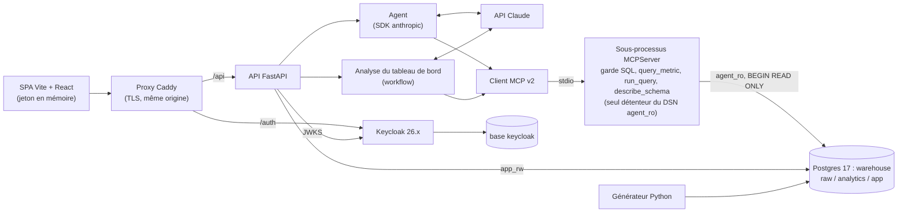

# System Design

Version 5 (MVP, proxy de même origine, MCP v2, flux POST + SSE). Complète [SRS.md](../SRS.md). Pour l'agent, voir [AGENTIC_DESIGN.md](AGENTIC_DESIGN.md). Origine des décisions : [EVALUATION_V5.md](EVALUATION_V5.md) §4 et [revue system design](reviews/2026-10-24-system-design.md).

Principe directeur : **le moins de composants possible, chacun justifié par une exigence.**

Sources de vérité (le texte les résume, il ne les recopie pas) :

| Sujet | Fichier |
|---|---|
| Contrats d'échange (outils, messages, journal) | `packages/core/src/decision_core/models.py` |
| Couche sémantique, KPI, paramètres | `semantic/{tables,kpis,glossary,config}.yaml` (+ `examples.yaml`, paquet agent) |
| Rôles, bases et schémas Postgres | `infra/postgres/init/` |
| Variables d'environnement | `packages/core/src/decision_core/settings.py` |

## 1. Décisions v5

| N° | Décision | Remplace |
|---|---|---|
| D1 | SPA **Vite + React + TypeScript** (bulletproof-react `react-vite`) ; reprise de `components/ui`, Radix, react-query, MSW, Storybook a11y, DOMPurify. Le dossier `frontend/` (Next.js) sera migré en P2 | Squelette Next.js |
| D2 | **API FastAPI minimale** : sans utilisateurs locaux, Redis, cache, Taskiq ni SQLAdmin ; quota calculé dans Postgres ; migrations Alembic par `app_owner` | Squelette Fastro (retiré) |
| D3 | SDK MCP **v2** (`MCPServer`, `mcp>=2.3,<3`) en stdio ; un sous-processus par worker ; seul détenteur du DSN `agent_ro` ; annulation `notifications/cancelled` → `pg_cancel_backend` | S3 précisé |
| D4 | Flux : **POST + format SSE** (`fastapi.sse`, FastAPI ≥ 0.135) lu par `fetch` ; événements `step`, `final`, `error` ; ping 15 s | S6 précisé |
| D5 | **Proxy Caddy de même origine** : `/` SPA, `/api` API, `/auth` Keycloak ; plus de CORS ; prérequis du mode production de Keycloak | Compose sans proxy |
| D6 | **Postgres 17** ; bases `warehouse` et `keycloak` ; rôles `dbt_owner`, `app_owner`, `app_rw`, `agent_ro_base`/`agent_ro`, `keycloak` | `init.sql` v4 |
| D7 | **Garde SQL renforcé** : liste blanche des types de nœuds, noms de fonctions normalisés, bornes de longueur et de profondeur, `BEGIN READ ONLY`, payloads de différentiel | §6 v4 complété |
| D8 | Configuration **dans Git, modifiée par PR** ; l'API lit les YAML au démarrage et calcule `semantic_version` ; back-office en lecture | `change_request` + commit par l'API |
| D9 | Événements d'authentification dans **Keycloak** ; avertissement sur la **session SSO** ; **Audience mapper** | ENF10 précisé |

## 2. Vue d'ensemble et composants



Un serveur Postgres, deux bases, cinq rôles de connexion. Un monolithe FastAPI héberge l'agent et lance le serveur MCP en **sous-processus stdio** : pas de conteneur MCP, pas de file de messages, pas de cache distribué. Le navigateur ne parle qu'au proxy. Rendu : [DIAGRAMS §1](DIAGRAMS.md#1-architecture-densemble).

### Composants

| Composant | Responsabilité | Technologie | Paquet | Exigences |
|---|---|---|---|---|
| Générateur | Données synthétiques, graine fixe, chargement par `COPY` dans `raw` | Python, NumPy | `packages/data_gen` (`decision_data_gen`) | ENF8 |
| Transformations | `raw` → étoile, tests de qualité, tests unitaires des KPI | dbt-core 1.11 + dbt-postgres | `warehouse/` | ENF8 |
| Entrepôt | Stockage, rôles, timeouts | Postgres 17 | `infra/postgres/` | ENF3 |
| Contrats | Modèles Pydantic partagés, couche sémantique, paramètres | Pydantic v2 | `packages/core` (`decision_core`) | — |
| Garde SQL | Bibliothèque pure : AST, liste blanche, réécriture, portée, règles sémantiques | sqlglot | `packages/sql_guard` (`decision_sql_guard`) | ENF3 |
| Serveur MCP | Seule porte d'accès aux données ; compile `query_metric` ; exécute en lecture seule | SDK `mcp` v2, psycopg | `packages/mcp_server` (`decision_mcp_server`) | ENF3, ENF9 |
| Agent | Boucle d'outils, registre de faits, validateur, formateur, analyse du tableau de bord | SDK `anthropic>=2.3,<3` | `packages/agent` (`decision_agent`) | RF1-RF3, RF5, RF14, RF17 |
| API | JWT, conversations, flux SSE, quota, écriture de `query_log`, filtrage par rôle, back-office en lecture | FastAPI ≥ 0.135, SQLAlchemy async, asyncpg, Alembic | `packages/api` (`decision_api`) | RF6, RF8, RF10, RF13, RF19, RF20, ENF5 |
| Évaluation | Exécuteur, comparateur, statistiques, rapports | Python | `packages/eval` (`decision_eval`) + `eval/` (jeux) | O1, O3 |
| Interface | Chat, graphiques, historique, tableau de bord, back-office | React, Vite, TypeScript | `frontend/` (à migrer, D1) | RF3, RF4, ENF7, ENF12 |
| Identité | Utilisateurs, rôles, MFA, force brute ; thème de connexion et d'OTP | Keycloak 26.x, Keycloakify | `infra/keycloak/` | RF11, RF15, RF16, ENF10 |
| Proxy | TLS, routage de même origine, en-têtes de sécurité | Caddy 2 | `infra/Caddyfile` | ENF4, ENF10 |

Le LLM est derrière une interface `LLMClient` (implémentations `AnthropicClient`, `ReplayClient`/`ScriptedClient` pour les tests sans clé).

## 3. Base de données

### Bases, schémas et rôles

Les scripts `infra/postgres/init/` (`00-roles.sh`, `sql/01-roles.sql`, `sql/02-warehouse.sql`) créent **seulement** rôles, bases, schémas et droits par défaut. Ils ne posent aucun droit sur une table : les tables `app` n'existent qu'après les migrations. Le texte ci-dessous résume ces scripts ; en cas d'écart, les scripts font foi.

| Rôle | Connexion | Rôle dans le système |
|---|---|---|
| `dbt_owner` | oui | Propriétaire des schémas `raw` et `analytics` ; exécute le chargement et dbt |
| `app_owner` | oui | Propriétaire du schéma `app` ; exécute les migrations Alembic et la purge de rétention |
| `app_rw` | oui | Utilisé par l'API et par `make eval` pour écrire les résultats ; DML minimal, posé par migration |
| `agent_ro_base` | non | Porte le droit `SELECT` sur `analytics` (droits par défaut `FOR ROLE dbt_owner`) |
| `agent_ro` | oui | Membre de `agent_ro_base` ; `CONNECTION LIMIT 8` ; `default_transaction_read_only`, `statement_timeout = 10s`, `idle_in_transaction_session_timeout = 15s`, `lock_timeout = 2s`, `work_mem = 16MB`, `temp_file_limit = 64MB` ; détenu par le seul sous-processus MCP |
| `keycloak` | oui | Propriétaire de la base `keycloak` |

| Schéma (base `warehouse`) | `dbt_owner` | `app_owner` | `app_rw` | `agent_ro` |
|---|---|---|---|---|
| `raw` | propriétaire | — | — | — |
| `analytics` | propriétaire | — | — | `SELECT` (droits par défaut) |
| `app` | — | propriétaire | `USAGE` + droits par table ci-dessous | — |

`public` est fermé (`REVOKE ALL … FROM PUBLIC`, exécution des fonctions retirée). Aucune extension `dblink`, `file_fdw` ni `adminpack`. Le MCP ouvre en plus chaque requête par `BEGIN READ ONLY`.

### Droits de `app_rw` par table (posés par la migration initiale, `app_owner`)

| Table | `SELECT` | `INSERT` | `UPDATE` | `DELETE` | Remarque |
|---|---|---|---|---|---|
| `conversation` | oui | oui | oui | oui | Filtre `user_id = sub` dans l'API ; suppression par son propriétaire (cascade sur `message`) |
| `message` | oui | oui | oui | oui | |
| `feedback` | oui | oui | oui | oui | Traitement : `status`, `reject_reason`, `promoted_to_dev`, `handled_by`, `handled_at` |
| `analysis` | oui | oui | oui | oui | Une ligne par génération |
| `query_log` | oui | oui | — | — | **Ajout seul** ; lu pour l'audit et le quota |
| `audit_access_log` | oui | oui | — | — | **Ajout seul** |
| `eval_run` | oui | oui | — | — | Écrit par `make eval` (`--write-db-env`) |
| `eval_result` | oui | oui | — | — | Écrit par `make eval` |

`TRUNCATE` n'est jamais accordé. La purge de rétention (`query_log` > 90 jours) est faite par `app_owner` (tâche planifiée), pas par l'API.

### Tables applicatives (schéma `app`, 8 tables)

```
conversation(id uuid PK, user_id text /* claim sub, sans FK */, title text, created_at, updated_at timestamptz)
message(id uuid PK, conversation_id uuid → conversation ON DELETE CASCADE, role text CHECK(user|assistant),
        content text, structured_json jsonb /* AssistantMessage complet, sql compris */, trace_id text,
        latency_ms int, created_at timestamptz)
query_log(id bigint PK, ts timestamptz default now(), trace_id text, step int, attempt int,
          user_ref text /* HMAC-SHA256 du sub */, conversation_id uuid, question_hash text /* HMAC */,
          tool text /* query_metric | run_query | describe_schema | llm */,
          status text CHECK(ok|error|blocked), error_class text, sql text, row_count int, truncated bool,
          duration_ms int, model_requested text, model_served text, effort text, stop_reason text,
          request_id text, ttft_ms int, tokens_in int, tokens_out int, tokens_cache_read int,
          tokens_cache_write int, cost_usd numeric(10,6), prompt_version text, semantic_version text)
feedback(id bigint PK, ts timestamptz, user_id text, message_id uuid → message, category text, comment text,
         consent_question bool, question_text text /* seulement avec consentement */,
         status text CHECK(nouveau|traite|rejete), reject_reason text, promoted_to_dev bool default false,
         handled_by text, handled_at timestamptz)
eval_run(id bigint PK, ts timestamptz, split text, ablation text, prompt_version text, semantic_version text,
         model_id text, git_sha text, data_hash text, reference_date date, n int, n_correct int,
         pass1 numeric, pass3 numeric, ci_low numeric, ci_high numeric, cache_off bool,
         report jsonb /* traçabilité complète : modèle servi, effort, hashes, jalon, coût, latence */)
eval_result(id bigint PK, run_id bigint → eval_run, question_id text, category text, trap text,
            passes int /* 0 à 3 */, expected jsonb, got jsonb)
audit_access_log(id bigint PK, ts timestamptz, actor_sub text, actor_role text, action text,
                 target_trace_id text, details jsonb)
analysis(id bigint PK, ts timestamptz, period_start date, period_end date, region text,
         semantic_version text, model_id text, payload jsonb /* DashboardAnalysis */, data_hash text, trace_id text)
```

Catégories de signalement : `chiffre_faux`, `mauvaise_comprehension`, `periode_ou_perimetre`, `refus_injustifie`, `autre`. Source de vérité du schéma : `packages/api/src/decision_api/migrations/versions/0001_schema_app.py`.

Les colonnes de `query_log` suivent `QueryLogRecord` (`decision_core.models`) ; la colonne `step` relie un appel LLM et les appels d'outils qu'il a déclenchés. Les utilisateurs n'ont pas de table locale : Keycloak est la source unique (`user_id` = claim `sub` dans `conversation` et `feedback` ; pseudonyme HMAC `user_ref` dans `query_log`). Le texte de la question n'est pas stocké dans `query_log` (condensat seulement) : il vit dans `message`, visible de son propriétaire.

Index : `conversation(user_id, created_at DESC)`, `message(conversation_id, created_at)`, `query_log(ts)`, `query_log(user_id, ts)`, `query_log(trace_id, step)`, `feedback(status, ts)`, `eval_result(run_id)`. Rétention du journal : 90 jours (`config.yaml`).

Rendu : [DIAGRAMS §4](DIAGRAMS.md#4-tables-applicatives).

### Modèle analytique

Voir [SRS §7](../SRS.md#7-modèle-de-données). Valeurs ASCII (`reussie`, `echouee`, `depot`…). Index sur `fact_transaction` : `date_id`, `client_id`, `agent_id`, index partiel `(date_id) WHERE statut = 'reussie'`. `ANALYZE` en hook post-run dbt.

Volumétrie cible : 50 000 clients, 2 000 agents, 18 mois (2025-04-01 → 2026-09-30), 1,5 à 3 M de transactions ; 5 à 10 % d'échecs, 10 à 15 % hors agent, montants log-normaux avec valeurs aberrantes, Dakar à 35-40 % du volume.

### Tests dbt (ENF8)

`unique` et `not_null` sur les clés ; `relationships` de chaque clé étrangère (y compris les membres −1) ; `accepted_values` sur `type`, `statut`, `segment`, `statut_agent` (valeurs ASCII) ; montant > 0, frais ≥ 0 et ≤ montant ; transfert et paiement ↔ agent −1 et région d'agent −1, dépôt et retrait ↔ agent réel ; `date_inscription` ≤ première transaction ; toute date du fait présente dans `dim_date` ; réconciliation `raw` ↔ `fact` ; `max(date) ≤ REFERENCE_DATE` ; tests unitaires dbt figeant les 6 KPI sur un petit jeu fixe ; test de droits de `agent_ro` (`INSERT`, `DROP`, `SELECT` sur `raw`/`app`, `pg_read_file()` : tous en échec).

## 4. Flux d'une question

```mermaid
sequenceDiagram
  participant W as SPA
  participant P as Proxy
  participant A as API
  participant G as Agent
  participant L as Claude
  participant M as MCP (stdio)
  participant D as Postgres
  W->>P: POST /api/conversations/{id}/messages (Bearer)
  P->>A: même origine
  A->>A: JWT, rôle, propriété (user_id = sub), quota (Postgres)
  A->>G: question + état résolu + 6 derniers échanges
  loop ≤ 6 appels LLM, ≤ 8 outils, 30 s
    G->>L: messages.stream (tool_choice auto, outils strict)
    L-->>G: tool_use (données) ou outil terminal
    G->>M: query_metric / run_query / describe_schema (délai restant)
    M->>M: garde SQL, EXPLAIN borné
    M->>D: BEGIN READ ONLY ; SELECT (agent_ro)
    D-->>M: ≤ 1 001 lignes
    M-->>G: ToolResult (sql réécrit, rows, duration_ms, truncated)
    G-->>A: QueryLogRecord (outil et LLM)
    A->>A: écrit query_log
    A-->>W: SSE step
  end
  G->>G: registre de faits → validateur → formateur (ou réponse gabarit)
  G-->>A: AssistantMessage
  A->>A: for_role(role) : retire sql pour le décideur ; écrit message
  A-->>W: SSE final (ou error)
```

- Le flux émet des événements `step` (`StepEvent` : intention, outil, validation, mise en forme) puis **un seul** `final` (`AssistantMessage` validé) ou `error`. Rien de non validé n'est affiché.
- Le client lit le flux par `fetch` + `ReadableStream` et un analyseur SSE ; `EventSource` n'est pas utilisé (pas d'en-tête `Authorization`). Aucun jeton en query string.
- Déconnexion du client : annulation de la tâche asyncio, donc fermeture du flux Claude, envoi de `notifications/cancelled` au MCP, puis `pg_cancel_backend`.
- Plafonds : 2 flux simultanés et 200 questions par jour et par utilisateur (`config.yaml`), calculés dans Postgres plus un sémaphore en mémoire.

Rendu : [DIAGRAMS §5](DIAGRAMS.md#5-flux-dune-question).

## 5. Interface HTTP

Toutes les routes sont servies sous `/api` par le proxy. Les rôles viennent de `resource_access["decision-web"].roles`.

| Méthode et chemin | Rôle | Autorisation |
|---|---|---|
| `GET /api/health` | Santé de l'API et du sous-processus MCP | public (sans détail) |
| `GET /api/me` | Profil et rôles | authentifié |
| `POST /api/conversations` / `GET /api/conversations` | Créer / lister les siennes | authentifié |
| `GET /api/conversations/{id}` | Messages ; 404 si autrui | propriétaire |
| `POST /api/conversations/{id}/messages` | Question ; réponse en **flux SSE** (`step`, `final`, `error`) | propriétaire |
| `GET /api/dashboard?period=&region=` | 6 KPI, période courante et précédente, dérivés (via `query_metric`) | authentifié |
| `POST /api/dashboard/analysis` | Analyse de l'agent (workflow, un appel LLM) ; corps `{period, region}` ; écrit `app.analysis` | authentifié |
| `POST /api/feedback` | Signaler une réponse (consentement explicite pour joindre la question) | propriétaire du message |
| `GET /api/admin/overview?range=` | Exploitation : requêtes, latence p50/p90, coût, taux de blocage du garde, santé | analyste, admin |
| `GET /api/admin/security`, `POST /api/admin/security/rights-test` | Sécurité : blocages du garde, dernier test de droits de `agent_ro`. L'API n'a pas le DSN `agent_ro` : `rights-test` relit le rapport produit par `make rights-test` (`var/rights-test.json`) et journalise la lecture | admin |
| `GET /api/admin/audit/queries` (+ `/export.csv`) | Journal technique (condensats, sans texte de question) ; l'export **écrit `audit_access_log`** | analyste, admin |
| `GET /api/admin/audit/queries/{trace_id}` | Détail d'un appel ; **écrit `audit_access_log`** | analyste, admin |
| `GET /api/admin/eval/runs`, `GET /api/admin/eval/runs/{id}` | Exécutions et résultats d'évaluation (lecture) | analyste, admin |
| `GET /api/admin/feedback`, `PATCH /api/admin/feedback/{id}` | Signalements ; `traite`, `rejete` (motif obligatoire), promotion vers le dev | analyste, admin |
| `GET /api/admin/kpis`, `GET /api/admin/semantic/{tables\|glossary\|examples}` | Catalogue de KPI et couche sémantique en lecture, avec `semantic_version` | analyste, admin |
| `GET /api/admin/settings` | Paramètres en lecture (sans secret) et lien vers la procédure de PR | admin |

Aucune route d'écriture de configuration ni de gestion d'utilisateurs. Plus de `GET /kpis/analysis`, de `/admin/users` ni de `/admin/change-requests`.

### Contrat `AssistantMessage` (résumé)

Défini dans `decision_core.models` (types TypeScript générés). Champs principaux :

| Champ | Contenu |
|---|---|
| `kind` | `answer`, `clarification`, `refusal`, `error` |
| `text` | Texte rendu par le code (gabarits `{{f…}}`/`{{d…}}` remplacés) |
| `period`, `scope` | Période (`start`, `end`, libellé français) et périmètre, rendus par le code depuis l'état résolu |
| `table`, `truncated`, `chart` | Données et graphique **calculés par le code** |
| `tables`, `sql` | Tables `analytics` utilisées ; liste des SQL exécutés (retirée pour le décideur par `for_role`) |
| `evidence` | Chaîne de preuve (`table`, `filtre`, `periode`, `operation`) |
| `facts` | Faits cités (identifiant, valeur, unité, libellé, rendu exact) |
| `caveats`, `certified`, `simplified` | Mises en garde ; `true` si chemin `query_metric` ; `true` si réponse gabarit |
| `clarification`, `follow_up` | Clarification en attente (2-3 options) ; questions de suivi |
| `resolved_state` | État résolu produit par le code (champs étiquetés `explicite`, `herite`, `defaut`) |
| `trace_id` | Lien avec `query_log` |

## 6. Sécurité en profondeur

### Authentification et accès
- Client Keycloak public `decision-web`, Authorization Code + PKCE (S256) ; pas de secret client dans la SPA ; jeton d'accès de 5 min en mémoire, renouvelé en silence.
- **Audience mapper** « Included Custom Audience » = `decision-api` sur une portée client dédiée (« Included Client Audience » donnerait un UUID interne).
- L'API valide `iss`, `aud`, `exp`, `nbf`, RS256 uniquement (refus de `none` et de HS), clé par `kid` (JWKS en cache avec rotation), rôles du seul client attendu.
- Toute requête applicative filtre `user_id = sub` ; 404 pour la ressource d'autrui ; tests d'accès croisé en CI.
- Même origine derrière Caddy : pas de CORS (liste vide par défaut), jeton en en-tête, donc pas de cookie ni de CSRF ; HSTS, CSP stricte, `X-Content-Type-Options`.
- Avertissement avant la fin de la **session SSO** (SSO Session Idle/Max), pas du jeton d'accès.

### Garde SQL (liste blanche, serveur MCP)

Bibliothèque `decision_sql_guard` : `guard_sql(sql, semantic, row_limit=…) → GuardResult(ok, sql, tables, error, scope)`. Parcours de **tout l'AST sqlglot** (CTE, sous-requêtes, jointures) puis **réécriture du SQL depuis l'AST validé**, seule version exécutée.

| Règle | Détail |
|---|---|
| Bornes avant analyse | Longueur ≤ `sql.max_sql_chars` (5 000) ; profondeur d'AST ≤ `sql.max_ast_depth` (40) |
| Instruction | Un seul `SELECT` ; refus de `INTO`, `FOR UPDATE`, `COPY`, CTE modifiantes, multi-instructions |
| Types de nœuds | Liste blanche des types sqlglot (et non liste noire) ; tout nœud inconnu est refusé |
| Tables | Uniquement `analytics.{fact_transaction, dim_client, dim_agent, dim_region, dim_date}` ; refus de `pg_catalog`, `information_schema`, `public` |
| Fonctions | Liste fermée (agrégats, `date_trunc`, `extract`, `coalesce`, `round`, `nullif`, `lower`, `upper`, opérateurs usuels) ; **noms normalisés** (minuscules, sans guillemets, sans schéma) avant comparaison |
| Limite | `LIMIT` imposé sur l'AST à `row_limit + 1` (1 001) pour détecter `truncated` |
| Coût | `EXPLAIN (FORMAT JSON)` : refus au-delà de `sql.max_plan_cost` |
| Exécution | `BEGIN READ ONLY` ; `statement_timeout` ≤ délai reçu ; lecture en flux |
| Portée | `scope` extrait de l'AST : bornes de `date_id`/`txn_ts`/`dim_date`, colonne de région jointe, prédicat sur `statut` ; comparé à `declared_scope` |
| Cohérence sémantique | Avertissements (`semantic_warnings`) : agrégat sans `statut = 'reussie'` (sauf `toutes`), « agent actif » sur `statut_agent`, région incohérente avec `region_kind`, dénominateur du taux d'échec filtré |
| Erreurs | Postgres normalisées et **actionnables** ; noms internes à `analytics` autorisés, le reste masqué |
| Journalisation | Refus du garde : `status = blocked`, `error_class = guard_blocked` |

Jeu de sécurité (≥ 25 payloads nommés) : CTE modifiante, `pg_read_file` (y compris `"pg_read_file"`, `pg_read_file/**/(`, `pg_catalog.pg_read_file`), `pg_ls_dir`, `dblink`, `set_config`, `pg_sleep`, `lo_import`, `pg_catalog`, `information_schema`, multi-instructions, commentaires, `E'\''`, `$$`, encodages Unicode, `generate_series` géante, `CROSS JOIN`, `LIMIT` énorme ; plus 5 injections indirectes. Rendu : [DIAGRAMS §8](DIAGRAMS.md#8-garde-sql).

`query_metric` : SQL compilé depuis `kpis.yaml`, paramètres liés, typés, filtres validés par énumération (régions de `kpis.yaml`), jamais interpolés ; passe aussi par le garde.

### Injection indirecte et rendu
Résultats d'outils en JSON typé, marqués « données non fiables » ; `nom` et `ville` remplacés par des étiquettes opaques dans la vue du modèle, réinjectés par le formateur ; au plus 50 lignes vers le modèle ; rendu React en texte brut ou Markdown assaini (pas de HTML, d'images ni de liens externes) ; validateur de sortie ([AGENTIC_DESIGN §7](AGENTIC_DESIGN.md#7-validateur-et-formateur)). L'agent ne peut modifier ni rôle ni périmètre d'un utilisateur.

### Back-office et authentification
- Les routes `/api/admin/*` vérifient le rôle **côté serveur**. La navigation masque les entrées interdites, mais c'est l'API qui refuse.
- Back-office **en lecture** : aucune action sensible applicative. La gestion des comptes (invitation, désactivation, MFA, sessions) se fait dans la console Keycloak, avec ses propres journaux d'administration.
- Le journal d'audit n'affiche jamais le texte d'une question. Le détail d'un appel écrit `audit_access_log`.
- Pages d'authentification : thème Keycloakify pour la connexion et l'OTP, thème de base aux jetons ailleurs ; messages neutres contre l'énumération ; pas d'écran « compte verrouillé ».

### Audit, secrets, exploitation
- `query_log` en ajout seul, écrit par `app_rw` : appels d'outils, appels LLM, refus du garde. Les échecs d'authentification sont dans les **événements Keycloak** (enregistrement activé, rétention configurée). Les lectures d'audit sont dans `audit_access_log`.
- Filtre de masquage dans les journaux JSON (clés, jetons, en-têtes) ; secrets via secrets Docker, `.env` hors image ; scan de secrets en pré-commit et CI.
- Keycloak en mode production, realm versionné **sans secret ni compte à mot de passe fixe**.
- Le flux vers le LLM externe (questions, résultats agrégés synthétiques) est documenté ([SRS §2](../SRS.md#2-périmètre)).

### Durcissements issus de la revue de code (2026-10-24)

Détail dans [reviews/2026-10-24-revue-code.md](reviews/2026-10-24-revue-code.md).

- **Quota** : chaque question ou analyse acceptée inscrit une ligne `query_log` (`tool = question | analysis`, `step = 0`) sous `pg_advisory_xact_lock` par utilisateur ; supprimer une conversation ne rend pas de quota. Le limiteur de flux est pris avant le quota.
- **Analyse du tableau de bord** : comptée dans le quota ; `regenerate` réservé à l'analyste et à l'admin, au plus une génération par minute et par (période, région) ; générations simultanées dédupliquées par verrou ; tuiles en cache mémoire 5 min.
- **Proxy** : corps limité à 64 Kio (Caddy et middleware ASGI, 413) ; seuls `/auth/realms/decision/*`, `/auth/resources/*` et `/auth/js/*` sont publiés ; console Keycloak sur `127.0.0.1:8081` (tunnel).
- **MFA** : le flux de réinitialisation applique le même contrôle OTP que la connexion ; avec `REQUIRE_MFA_CLAIM` (vrai en production), l'API refuse un jeton d'analyste ou d'admin sans `otp` dans `amr`.
- **Santé** : `/api/health` sonde réellement le sous-processus MCP (relancé avec backoff s'il meurt) et signale l'agent indisponible sans clé Claude ; `status = ok | degraded | down`.
- **Injection indirecte** : le serveur MCP marque `free_text` toute projection issue de `dim_agent.nom` ou `ville` (lignage sur l'AST, alias et fonctions compris) ; l'agent opacifie d'après ce drapeau.
- **Garde** : mots-clés niladiques (`user`, `current_role`…) refusés ; jointure sans `OR` au premier niveau et avec une égalité entre deux alias distincts.
- **Données** : le serveur MCP connaît les bornes des données ; une comparaison hors données est refusée, une couverture partielle est signalée ; une comparaison qui chevauche la période courante est refusée.
- **Secrets** : `AGENT_RO_DSN` n'est plus exporté dans l'environnement de l'API (lu depuis un fichier secret puis transmis au seul sous-processus MCP) ; démarrage refusé en production avec la clé de pseudonymisation par défaut ; purge de `query_log` par `make purge-logs` (`app_owner`).

## 7. Déploiement

Un seul `docker compose` (`infra/compose.yaml`).

| Service | Image | Notes |
|---|---|---|
| `proxy` | caddy 2.x | TLS interne, routes `/`, `/api`, `/auth` ; CSP, HSTS ; sert les fichiers statiques de la SPA |
| `api` | Python 3.12 + uv | FastAPI + agent ; lance le MCP en sous-processus ; secrets `anthropic_api_key`, `app_rw_password`, `agent_ro_password`, `log_pseudonym_key` |
| `keycloak` | quay.io/keycloak/keycloak:26.x (version figée) | `start --optimized`, base `keycloak`, `hostname`, `proxy-headers=xforwarded` ; thème monté en `.jar` ; événements activés |
| `postgres` | postgres:17 | Volume ; `infra/postgres/init/` monté dans `/docker-entrypoint-initdb.d` |
| `mailpit` | axllent/mailpit | Développement seulement (RF16) |
| `migrate` | image de l'API | Alembic (`app_owner`) à chaque démarrage, avant l'API |
| `tools` | `infra/tools.Dockerfile` (profil `tools`) | Développement : dépôt monté, uv + dbt + make ; exécute les cibles du Makefile (`make dc-*`) dans le réseau Docker avec les secrets |

Deux modes de travail, mêmes cibles : en local (`make init`, Postgres jetable sans Docker) ou en conteneurs (`make dc-init`, `make dev-up` qui ajoute `infra/compose.dev.yaml` : jetons locaux, Swagger, API sur la boucle locale). Détail dans le [README](../README.md).

| Tâche | Contenu |
|---|---|
| `make seed` | Générateur → `raw` → `dbt build` (tests compris) → test de droits |
| `make migrate` | Alembic avec `app_owner` |
| `make eval` | Appelle **directement** `Agent.answer` (sans Keycloak, `role = analyste`, utilisateur technique) ; écrit `eval_run`/`eval_result` avec `app_rw` |
| `make bench` | Banc HTTP de latence (O2) à travers le proxy, avec un jeton technique |

Import du realm : `--import-realm` n'écrase pas un realm existant ; procédure de réinitialisation documentée. Variables dans `.env.example`. En local sans Docker, `scripts/dev_pg.sh` lance un Postgres jetable (binaires 16, mêmes rôles ; aucune fonction propre à 17 n'est utilisée). Rendu : [DIAGRAMS §13](DIAGRAMS.md#13-déploiement-compose).

## 8. Observabilité

`query_log` (métier) et journaux JSON (technique, MCP sur stderr) liés par `trace_id` et `step`. Latences mesurées par étape (porte, outil, LLM avec `ttft_ms`), agent seul et bout en bout. Taux de lecture du cache = `cache_read / (cache_read + cache_write + in)` ; alerte sous 70 % dans RF20. Pas de pile de supervision au départ.

## 9. Structure du dépôt

```
decision-agent-IA/
├── SRS.md, docs/                 # documents v5, docs/reviews/, docs/diagrams/
├── pyproject.toml, uv.lock       # espace de travail uv unique (membres packages/*)
├── packages/
│   ├── core/          decision_core       # contrats Pydantic, couche sémantique, paramètres
│   ├── sql_guard/     decision_sql_guard  # bibliothèque pure, payloads
│   ├── mcp_server/    decision_mcp_server # MCPServer stdio (python -m decision_mcp_server)
│   ├── agent/         decision_agent      # boucle, outils, LLMClient, faits, validateur, formateur, tableau de bord
│   ├── api/           decision_api        # FastAPI, migrations Alembic, routes /api et /api/admin
│   ├── data_gen/      decision_data_gen   # générateur synthétique
│   └── eval/          decision_eval       # exécuteur, compare.py, statistiques, rapports
├── semantic/          # tables, kpis, glossary, config (.yaml) ; examples.yaml (paquet agent)
├── warehouse/         # projet dbt
├── eval/              # jeux : test.yaml (hash figé), dev, intent, followup, security, regression, analysis
├── infra/             # compose.yaml, Caddyfile, postgres/init/, keycloak/ (realm sans secret, thème)
├── scripts/           # dev_pg.sh (Postgres local jetable)
└── frontend/          # SPA ; migration Next.js → Vite prévue en P2 (D1, SRS Q-g)
```

Le squelette `api/` (Fastro) est retiré. Le squelette `frontend/` (Next.js, ne compile pas) reste en attendant sa migration.

## 10. Décisions (ADR)

| N° | Décision | Raison | Écarté |
|---|---|---|---|
| S1 | Postgres d'abord (17) | Rôles réels (ENF3), gratuit, reproductible, support long | Snowflake, DuckDB ; Postgres 16 |
| S2 | Snowflake en Could via un second target dbt | Portabilité de **dbt** seulement | Snowflake dès le départ |
| S3 | Monolithe FastAPI, MCP v2 en sous-processus stdio | Moins de pièces ; l'API écrit seule `query_log` ; **séparation des identifiants** (seul le sous-processus a le DSN `agent_ro`) | Conteneur MCP, connecteur MCP de l'API (HTTP public, hors ZDR) |
| S4 | Keycloak, client public PKCE ; **RF11 dans la console Keycloak** | Décision utilisateur ; aucun proxy vers l'API d'administration au MVP | Auth maison ; écrans B02-B04 |
| S5 | `AssistantMessage` unique, `sql` filtré côté serveur (`for_role`) | L'interface ne devine rien ; pas de fuite du SQL | Masquage côté interface |
| S6 | **POST + format SSE** lu par `fetch` ; `step` puis un seul `final` | Latence perçue sans afficher du non validé ; en-tête `Authorization` conservé | `EventSource`, SSE de texte brut, WebSocket |
| S7 | `REFERENCE_DATE` partout | Reproductibilité | `now()` |
| S8 | Pas de cache de réponses ni de SQL ; cache de prompt autorisé | Mauvais contexte en suivi ; masquerait la variance | Cache par question |
| S9 | Rôles Postgres séparés (`dbt_owner`, `app_owner`, `app_rw`, `agent_ro`, `keycloak`), droits par défaut explicites | `dbt run` recrée les tables ; le propriétaire des tables ne doit pas être le rôle de l'API | Rôle unique ; `app_rw` propriétaire |
| S10 | Back-office dans la même SPA (routes `/admin`), **en lecture** | Un déploiement, mêmes composants | Seconde application ; SQLAdmin |
| S11 | **Configuration modifiée par PR Git** ; l'API la lit et calcule `semantic_version` | Revue obligatoire par la protection de branche ; aucun identifiant Git dans le conteneur | `change_request` + commit par l'API |
| S12 | Pages d'authentification en thème Keycloak (Keycloakify : connexion, OTP) | Aucun mot de passe ne transite par nos services | Pages maison |
| S13 | Aucune table locale d'utilisateurs | Source de vérité unique : Keycloak | Copie locale |
| S14 | Analyse du tableau de bord en **workflow** sur `query_metric` | Chiffres traçables, un appel LLM, évaluation simple | Boucle d'outils, SQL généré |
| S15 | Proxy Caddy de même origine | Plus de CORS ; prérequis du mode production Keycloak ; CSP simple | Compose sans proxy, CORS en liste blanche |
| S16 | Init Postgres limité aux rôles, bases et schémas ; droits de table par migration | Les tables n'existent pas à l'init ; corrige le `init.sql` v4 | Script unique avec `REVOKE` sur des tables absentes |
| S17 | Événements d'authentification dans Keycloak ; `audit_access_log` pour les lectures d'audit | Chaque événement là où il se produit | Tout dans `query_log` |
| S18 | Espace de travail uv, un paquet par composant | Tests isolés, dépendances explicites, contrats partagés dans `core` | Dépôt plat |
