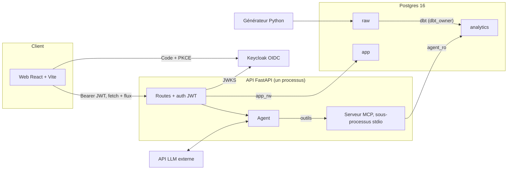
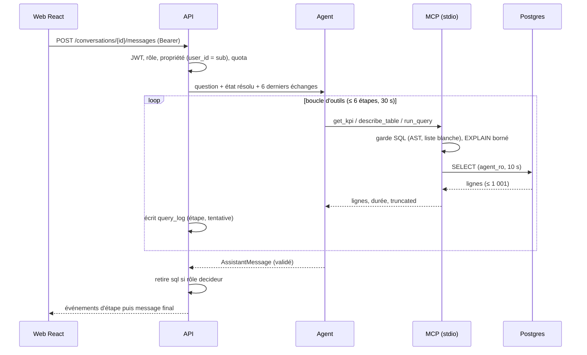

# System Design

Version 4 (back-office, authentification, analyse du tableau de bord). Complète [SRS.md](../SRS.md). Pour l'agent, voir [AGENTIC_DESIGN.md](AGENTIC_DESIGN.md).

Principe directeur : **le moins de composants possible, chacun justifié par une exigence.**

## 1. Vue d'ensemble



Un serveur Postgres, trois schémas, trois rôles. Un monolithe FastAPI héberge l'agent et lance le serveur MCP en **sous-processus stdio** : pas de conteneur MCP, pas de file de messages, pas de cache distribué.

## 2. Composants

| Composant | Responsabilité | Technologie | Exigences |
|---|---|---|---|
| Générateur | Données synthétiques réalistes, graine fixe, chargement par `COPY` | Python, Faker, NumPy | ENF8 |
| Transformations | `raw` → étoile, tests de qualité, `grants` | dbt-postgres | ENF8, SRS §7 |
| Entrepôt | Stockage, rôles, timeouts | Postgres 16 | ENF3 |
| Serveur MCP | Seule porte d'accès aux données pour l'agent ; garde SQL | Python, SDK MCP, sqlglot, psycopg | ENF3, ENF9 |
| Agent | Boucle d'outils, sortie structurée | SDK du fournisseur LLM | RF1, RF2, RF14 |
| API | JWT, conversations, relais vers l'agent, écriture de `query_log`, filtrage par rôle | FastAPI, Pydantic v2, SQLAlchemy | RF5, RF6, RF8, RF13, ENF5 |
| Interface | Chat, graphiques, historique, KPI, vue SQL (analyste) | React, Vite, TypeScript, Recharts | RF3, RF4, ENF7 |
| Identité | Utilisateurs, rôles, SSO, MFA, verrouillage ; **pages d'authentification au thème du produit** (connexion, mot de passe oublié, réinitialisation, code à 6 chiffres, première connexion, compte verrouillé) ; API d'administration utilisée par le back-office via un compte de service limité | Keycloak, thème personnalisé | RF11, RF15, RF16, ENF10 |
| Back-office | 9 vues sous `/admin` : vue d'ensemble, utilisateurs, catalogue de KPI, couche sémantique, journal d'audit, sécurité, évaluation, signalements, paramètres ; rôles vérifiés côté serveur | React (feature `admin`), routes API `/admin/*` | RF9, RF11 à RF13, RF18 à RF20, ENF11 |
| Analyse du tableau de bord | Constats sourcés, niveaux de confiance, hypothèses étiquetées ; l'agent en mode analyse n'utilise que `get_kpi` | Agent, `GET /kpis/analysis` | RF17 |

Le LLM est derrière une interface mince (`LLMClient`).

## 3. Base de données

### Schémas et rôles

| Schéma | Contenu | `dbt_owner` | `app_rw` | `agent_ro` |
|---|---|---|---|---|
| `raw` | Tables brutes | écriture | — | — |
| `analytics` | Étoile | écriture | — | lecture |
| `app` | `conversation`, `message`, `query_log` | — | écriture | — |

Un changement de base ou de cluster séparé pour `app` reste possible si la confidentialité des questions l'exige.

### Initialisation Postgres (`infra/postgres/init.sql`)

```sql
-- Rôles
CREATE ROLE dbt_owner LOGIN;  CREATE ROLE app_rw LOGIN;
CREATE ROLE agent_ro_base NOLOGIN;
CREATE ROLE agent_ro LOGIN IN ROLE agent_ro_base CONNECTION LIMIT 5;

-- Retirer les accès par défaut
REVOKE ALL ON SCHEMA public FROM PUBLIC;
REVOKE ALL ON SCHEMA raw, app FROM PUBLIC, agent_ro_base;
REVOKE EXECUTE ON ALL FUNCTIONS IN SCHEMA public FROM PUBLIC;

-- agent_ro : lecture de analytics uniquement
GRANT USAGE ON SCHEMA analytics TO agent_ro_base;
GRANT SELECT ON ALL TABLES IN SCHEMA analytics TO agent_ro_base;
ALTER DEFAULT PRIVILEGES FOR ROLE dbt_owner IN SCHEMA analytics
  GRANT SELECT ON TABLES TO agent_ro_base;   -- survit aux recréations par dbt run

ALTER ROLE agent_ro SET search_path = analytics;
ALTER ROLE agent_ro SET default_transaction_read_only = on;
ALTER ROLE agent_ro SET statement_timeout = '10s';
ALTER ROLE agent_ro SET idle_in_transaction_session_timeout = '15s';
ALTER ROLE agent_ro SET lock_timeout = '2s';
ALTER ROLE agent_ro SET work_mem = '16MB';
ALTER ROLE agent_ro SET temp_file_limit = '64MB';

-- Journal en ajout seul
REVOKE UPDATE, DELETE, TRUNCATE ON app.query_log FROM app_rw;
```

Aucune extension `dblink` ni `file_fdw`. Le test de droits (CI) exécute `INSERT`, `DROP`, `SELECT` sur `raw`/`app` et `pg_read_file()` avec `agent_ro` et vérifie l'échec.

### Tables applicatives

```
conversation(id uuid, user_id text /* claim sub, sans FK */, title, created_at timestamptz)
message(id, conversation_id → CASCADE, role, content, structured_json jsonb, created_at)
query_log(id, trace_id, step int, attempt int, ts timestamptz default now(), user_id,
          conversation_id, question_hash, tool, sql text, row_count int, truncated bool,
          duration_ms int, status CHECK(ok|error|blocked), error_class,
          tokens_in int, tokens_out int, tokens_cached int, cost_usd numeric(10,6),
          prompt_version, semantic_version, model_id)
```

Tables ajoutées pour le back-office et l'analyse :

```
feedback(id, ts, user_id, message_id → message, category, comment, consent_question bool,
         status CHECK(nouveau|en_analyse|corrige|rejete), reject_reason, assignee, promoted_to_dev bool)
change_request(id, kind CHECK(kpi|semantic|settings), target, author_id, reviewer_id,
               status CHECK(brouillon|en_revue|valide|rejete|applique), diff_text,
               created_at, decided_at, commit_sha)
eval_run(id, ts, split CHECK(dev|test), prompt_version, semantic_version, model_id, git_sha,
         data_hash, reference_date, n, n_correct, ci_low, ci_high, cache_off bool)
eval_result(run_id, question_id, category, trap, passes int /* 0 à 3 */, expected, got)
audit_access_log(id, ts, admin_id, action, target_trace_id)   -- ajout seul, comme query_log
analysis(id, ts, period, region, semantic_version, model_id, payload jsonb, kpi_trace_id)
```

Les utilisateurs n'ont pas de table locale : Keycloak est la source unique (`user_id` = claim `sub`). Les fichiers `kpis.yaml`, `glossary.yaml`, `examples.yaml` et `config.yaml` restent la source de vérité ; `change_request` ne garde que le diff et la décision, l'application passe par un commit.

Index : `conversation(user_id, created_at DESC)`, `message(conversation_id, created_at)`, `query_log(ts)`, `(user_id, ts)`, `(trace_id, step)`. Le texte de la question n'est pas stocké dans `query_log` (hash seulement) : il vit dans `message`, visible de son propriétaire. Rétention du journal : 90 jours (configurable).

### Modèle analytique

Voir SRS §7. Index sur `fact_transaction` : `date_id`, `client_id`, `agent_id`, index partiel `(date_id) WHERE statut = 'réussie'`. `ANALYZE` en hook post-run dbt.

Volumétrie cible : 50 000 clients, 2 000 agents, 18 mois, 1,5 à 3 M de transactions ; 5 à 10 % d'échecs, 10 à 15 % hors agent, montants log-normaux avec valeurs aberrantes, Dakar à 35-40 % du volume.

### Tests dbt (ENF8)

`unique` et `not_null` sur les clés ; `relationships` de chaque clé étrangère (y compris le membre −1) ; `accepted_values` sur `type` et `statut` ; montant > 0, frais ≥ 0 et ≤ montant ; transfert et paiement ↔ agent −1, dépôt et retrait ↔ agent réel ; `date_inscription` ≤ première transaction ; toute date du fait présente dans `dim_date` ; réconciliation `raw` ↔ `fact` (comptes et sommes) ; `max(date) ≤ REFERENCE_DATE` ; tests unitaires dbt figeant les 6 KPI sur un petit jeu fixe ; test de droits de `agent_ro`.

## 4. Flux d'une question



Le flux émet des **événements d'étape** (intention reconnue, outil en cours) puis le **message final validé** : rien de non validé n'est affiché. Le client utilise `fetch` avec lecture de flux (pas `EventSource`, qui ne permet pas l'en-tête `Authorization`) ; aucun jeton en query string. Déconnexion → annulation de la requête SQL et de l'appel LLM. Plafond de durée et de flux simultanés par utilisateur.

## 5. Interface HTTP

| Méthode et chemin | Rôle | Autorisation |
|---|---|---|
| `GET /me` | Profil et rôles | authentifié |
| `POST /conversations` / `GET /conversations` | Créer / lister les siennes | authentifié |
| `GET /conversations/{id}` | Messages ; 404 si autrui | propriétaire |
| `POST /conversations/{id}/messages` | Question (flux) | propriétaire |
| `GET /kpis` | KPI du tableau de bord (Should) | authentifié |
| `GET /kpis/analysis?period=&region=` | Analyse de l'agent (mode analyse, `get_kpi` seul) | authentifié |
| `POST /feedback` | Signaler une réponse (consentement explicite pour joindre la question) | propriétaire du message |
| `GET /admin/overview?range=` | Requêtes, latence, coût, santé des composants | analyste, admin |
| `GET /admin/users`, `POST /admin/users/invite`, `PATCH /admin/users/{id}`, `POST /admin/users/{id}/reset-mfa`, `DELETE /admin/users/{id}/sessions/{sid}` | Proxy vers l'API d'administration Keycloak ; ré-authentification récente exigée pour les actions sensibles | admin |
| `GET /admin/kpis`, `GET /admin/semantic/{tables,glossary,examples}` | Lecture du catalogue et de la couche sémantique | analyste, admin |
| `POST /admin/change-requests`, `POST /admin/change-requests/{id}/approve` | Soumission et validation (relecteur ≠ auteur) | analyste, admin |
| `GET /admin/audit/queries`, `GET /admin/audit/queries/{trace_id}` | Journal technique et détail d'un appel ; chaque lecture du détail écrit `audit_access_log` | analyste, admin |
| `GET /admin/security`, `POST /admin/security/rights-test` | Blocages, matrice de droits, test de droits de `agent_ro`, sessions | admin |
| `GET /admin/eval/runs`, `POST /admin/eval/runs` | Historique et lancement (quota d'exécutions du jeu de test) | analyste, admin |
| `GET /admin/feedback`, `PATCH /admin/feedback/{id}` | Signalements et leur traitement | analyste, admin |
| `GET /admin/settings` | Paramètres courants ; tout changement passe par une demande de changement | admin |

Contrat `AssistantMessage` (schéma Pydantic, types TypeScript générés) :

```
kind: "answer" | "clarification" | "refusal"
text: str, period: str, scope: str
table?: {columns, rows}, truncated: bool
chart?: {type, x, y, series}      # calculé par le code, pas par le LLM
tables: [str]
sql?: str                         # présent uniquement si rôle analyste (retiré côté serveur)
resolved_state: {kpi, période, périmètre, filtres}
```

## 6. Sécurité en profondeur

### Authentification et accès
- Client Keycloak public, Authorization Code + PKCE ; pas de secret client dans le SPA ; jeton d'accès de 5 min conservé en mémoire (pas de `localStorage`).
- L'API valide `iss`, `aud`, `exp`, `nbf`, algorithme RS256 uniquement (refus de `none` et de HS), clé par `kid` (JWKS en cache avec rotation), rôles du seul client attendu.
- Toute requête applicative filtre `user_id = sub` ; 404 pour la ressource d'autrui ; tests d'accès croisé en CI.
- CORS : origines exactes en liste blanche, jamais `*` ; jeton en en-tête, donc pas de cookie ni de CSRF ; HSTS, CSP stricte, `X-Content-Type-Options`.

### Garde SQL (liste blanche, serveur MCP)
Parcours de **tout l'AST sqlglot** (CTE, sous-requêtes, jointures) puis **réécriture du SQL depuis l'AST validé**, qui est la seule version exécutée.

| Règle | Détail |
|---|---|
| Instruction | Un seul `SELECT` ; refus de `INTO`, `FOR UPDATE`, `COPY`, CTE modifiantes, multi-instructions |
| Tables | Uniquement `analytics.{fact_transaction, dim_client, dim_agent, dim_region, dim_date}`, qualifiées ; refus de `pg_catalog`, `information_schema`, `public` |
| Fonctions | Liste fermée : agrégats, `date_trunc`, `extract`, `coalesce`, `round`, `nullif`, `lower`, `upper`, opérateurs usuels ; tout autre appel refusé (donc `pg_*`, `generate_series`, `set_config`, `dblink`) |
| Limite | `LIMIT` imposé sur l'AST (écrase une valeur plus grande) ; 1 001 en interne pour détecter `truncated` |
| Coût | `EXPLAIN (FORMAT JSON)` : refus au-delà d'un seuil de coût ou en cas de produit cartésien ; jointures limitées |
| Lecture | Résultats lus en flux, sans `fetchall` |
| Erreurs | Messages Postgres normalisés (classe d'erreur, sans noms d'objets) avant retour à l'agent |
| Journalisation | Les refus du garde sont journalisés (`status = blocked`) |

Jeu de sécurité (≥ 25 payloads nommés) : CTE modifiante, `pg_read_file`, `pg_ls_dir`, `dblink`, `set_config`, `pg_sleep`, `lo_import`, `pg_catalog`, `information_schema`, multi-instructions, commentaires, encodages Unicode, `generate_series` géante, `CROSS JOIN`, `LIMIT` énorme.

`get_kpi` : paramètres liés (`:param`), typés, filtres validés par énumération, jamais interpolés. Modifier `kpis.yaml` exige une revue de code.

### Injection indirecte et rendu
Résultats d'outils renvoyés en JSON typé, encadrés et marqués « données non fiables » ; colonnes de texte libre (`nom`, `ville`) exclues du contexte LLM sauf nécessité, tronquées et nettoyées ; rendu React en texte brut ou Markdown assaini (pas de HTML, d'images ni de liens externes) ; validateur de sortie (AGENTIC §6). L'agent ne peut modifier ni rôle ni périmètre d'un utilisateur.

### Back-office et authentification
- Les routes `/admin/*` vérifient le rôle **côté serveur** (claim du client attendu). La navigation masque les entrées interdites, mais c'est l'API qui refuse.
- Le compte de service Keycloak ne gère que les utilisateurs et sessions du royaume (pas d'administration du royaume).
- Actions sensibles (désactiver un compte, réinitialiser la MFA, révoquer une session, valider une demande de changement) : ré-authentification de moins de 5 min, puis journalisation.
- Demandes de changement : le diff est calculé côté serveur sur les fichiers versionnés ; les validations automatiques (paramètres liés, tables autorisées, anti-fuite exemples/test) tournent avant la décision ; l'auteur ne peut pas valider ; l'application se fait par commit, jamais par écriture directe.
- Le journal d'audit n'affiche jamais le texte d'une question (condensat seulement). Le détail d'un appel et l'export CSV écrivent `audit_access_log`.
- Pages d'authentification : thème Keycloak sans logique propre ; messages neutres contre l'énumération de comptes ; limitation de débit ; aucun secret dans le thème. Session expirée : avertissement 20 s avant l'expiration du jeton, avec prolongation.

### Audit, secrets, exploitation
- `query_log` en ajout seul, écrit par `app_rw` ; on y trace aussi refus du garde, échecs d'authentification et lectures de `/audit/queries` ; versions de prompt, de couche sémantique et de modèle incluses.
- Filtre de masquage dans les journaux JSON (clés, jetons, en-têtes) ; secrets via secrets Docker, `.env` hors image ; scan de secrets en pré-commit et CI.
- Keycloak en mode production, realm versionné **sans secret ni compte à mot de passe fixe**.
- Le flux vers le LLM externe (questions, résultats synthétiques) est documenté (SRS §2).

## 7. Déploiement

Un seul `docker compose` : `postgres`, `keycloak`, `api` (FastAPI + agent + MCP en sous-processus), `web`.

- `make seed` : génère, charge, lance dbt et ses tests.
- `make eval` : appelle **directement le module agent** (sans Keycloak, avec un `user_id` technique), cache désactivé par construction.
- Import du realm : n'actualise pas un realm existant ; procédure de réinitialisation documentée.
- Variables dans `.env.example`.

## 8. Observabilité

`query_log` (métier) et journaux JSON (technique) liés par `trace_id` et `step`. Latences mesurées par étape (porte, outil, LLM), agent seul et bout en bout. Pas de pile de supervision au départ.

## 9. Structure du dépôt

```
decision-agent-IA/
├── SRS.md
├── docs/
├── infra/        # compose, keycloak/{realm.json (sans secret), theme/}, postgres/init.sql
├── data_gen/
├── warehouse/    # dbt
├── mcp_server/   # garde SQL + outils
├── agent/        # boucle, prompts, semantic/{tables,kpis,glossary,examples}.yaml
├── api/
├── web/          # React + Vite, features/{conversation,dashboard,auth,admin}
└── eval/         # dev.yaml, test.yaml, compare.py, rapports
```

## 10. Décisions (ADR)

| N° | Décision | Raison | Écarté |
|---|---|---|---|
| S1 | Postgres d'abord | Rôles réels (ENF3), gratuit, reproductible | Snowflake, DuckDB |
| S2 | Snowflake en Could via un second target dbt | Portabilité de **dbt** seulement ; le SQL et les prompts de l'agent restent propres à Postgres | Snowflake dès le départ |
| S3 | Monolithe FastAPI, MCP en sous-processus stdio | Moins de pièces ; l'API écrit seule `query_log` | Conteneur MCP, microservices |
| S4 | Keycloak, client public PKCE | Décision utilisateur ; RF11 délégué | Auth maison |
| S5 | `AssistantMessage` unique, `sql` filtré côté serveur | L'interface ne devine rien ; pas de fuite du SQL | Masquage côté interface |
| S6 | Flux d'événements d'étape puis message validé | Latence perçue sans afficher du non validé | SSE de texte brut |
| S7 | `REFERENCE_DATE` partout | Reproductibilité | `now()` |
| S8 | Pas de cache SQL | Mauvais contexte en suivi ; masque la variance de l'évaluation | Cache par question |
| S9 | Trois rôles Postgres, droits par défaut explicites | `dbt run` recrée les tables ; moindre privilège | Un rôle unique |
| S10 | Back-office dans la même application React (routes `/admin`) | Un déploiement, mêmes composants et jetons de design | Seconde application |
| S11 | Changements de configuration par demandes de changement et commits versionnés | Revue obligatoire, historique Git, pas d'écriture directe | Édition en base |
| S12 | Pages d'authentification en thème Keycloak | Aucun mot de passe ne transite par nos services | Pages maison avec API de connexion |
| S13 | Utilisateurs lus et modifiés via l'API d'administration Keycloak, sans table locale | Source de vérité unique | Copie locale des utilisateurs |
| S14 | Analyse du tableau de bord en lecture seule sur `get_kpi` | Chiffres traçables, pas de SQL libre | Analyse par SQL généré |
