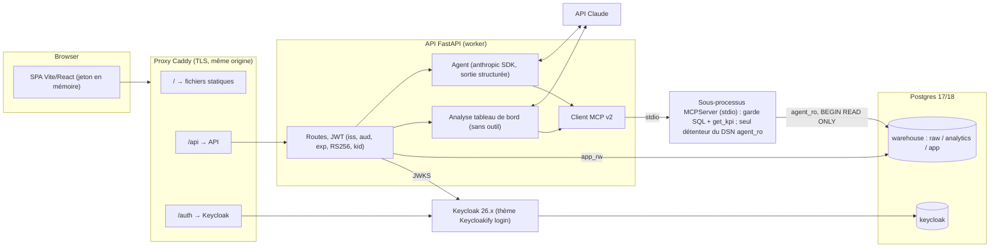

# Revue du System Design — Agent d'aide à la décision (Wave, données synthétiques)

Date de la revue : 2026-10-24. Périmètre lu : `SRS.md` (v4), `docs/SYSTEM_DESIGN.md` (v4), `docs/AGENTIC_DESIGN.md` (v4), `docs/FEATURES_RESOURCES.md` (v2), `docs/DIAGRAMS.md`, `docs/DESIGN_SYSTEM.md` (en-tête), squelettes `api/` et `frontend/`. Aucun fichier du dépôt n'a été modifié.

Verdict en une phrase : **le cœur (étoile dbt, MCP en lecture seule, garde SQL, `get_kpi`, évaluation avec Wilson et ablations) est solide et bien argumenté ; l'enveloppe (back-office en écriture, Keycloak entièrement thémé, 45 écrans) est surdimensionnée pour un mémoire, et les deux squelettes vont à l'encontre de décisions déjà actées (pas d'utilisateurs locaux, pas de cache, SPA Vite).** Deux hypothèses sont aussi rendues caduques par l'état actuel de l'API Claude (température, `tool_choice` forcé).

---

## 1. Cohérence interne des documents

Légende : **[B]** bloquant (à trancher avant le code), **[M]** majeur (incohérence de contrat ou faisabilité), **[m]** mineur (rédaction).

### 1.1 Contrats d'API et composants

| # | Gravité | Constat | Références |
|---|---|---|---|
| 1 | [M] | L'analyse du tableau de bord est `GET /kpis/analysis?period=&region=` dans SYSTEM_DESIGN, mais `GET /dashboard` puis `POST /dashboard/analysis` dans DIAGRAMS. Le tableau de bord lui-même s'appelle `GET /kpis` d'un côté, `GET /dashboard` de l'autre. | SYSTEM_DESIGN.md:52, :177, :178 ; DIAGRAMS.md:292, :296 |
| 2 | [M] | `GET` ne convient pas pour l'analyse : l'appel coûte un appel LLM, écrit `app.analysis` et peut être régénéré (AGENTIC §14). Il n'est donc pas sûr ni idempotent. C'est `POST` qu'il faut garder. | SYSTEM_DESIGN.md:178 vs AGENTIC_DESIGN.md:158 ; DIAGRAMS.md:301 |
| 3 | [M] | Mode analyse : AGENTIC dit que l'agent a **un outil, `get_kpi`**. DIAGRAMS montre au contraire l'**API** qui appelle `get_kpi` ×6 puis transmet les valeurs à l'agent, qui n'a alors aucune raison d'appeler un outil. Il faut choisir (voir §5, D9 : aucun outil, valeurs injectées). | AGENTIC_DESIGN.md:151-154 ; SRS.md:141, :149 ; DIAGRAMS.md:293-298 |
| 4 | [M] | Le contrat de retour du MCP diffère : le SRS dit `(sql, lignes, durée, truncated)`, AGENTIC et le diagramme de séquence disent `(lignes, durée, truncated)`. Or l'API a besoin du SQL **réécrit depuis l'AST** pour `query_log` et RF8. | SRS.md:137 ; AGENTIC_DESIGN.md:71 ; SYSTEM_DESIGN.md:159 ; DIAGRAMS.md:214 |
| 5 | [m] | Le back-office compte « 9 vues » dans SYSTEM_DESIGN et « 13 écrans » ailleurs. Les deux chiffres sont compatibles (9 sections de navigation, 13 écrans B01-B13), mais ce n'est écrit nulle part. | SYSTEM_DESIGN.md:51 ; SRS.md:205, :224 ; FEATURES_RESOURCES.md:40 |
| 6 | [m] | `GET /admin/overview` est ouvert à l'analyste alors que RF20 (exploitation : santé, coûts, latence) est réservé à l'admin dans le SRS et dans le diagramme des droits. | SYSTEM_DESIGN.md:180 ; SRS.md:77 ; DIAGRAMS.md:52 |
| 7 | [m] | Le composant « Agent » utilise encore le « SDK du fournisseur LLM » et le fournisseur reste un « point à trancher », alors que Claude est retenu. | SYSTEM_DESIGN.md:47, :54 ; FEATURES_RESOURCES.md:84 |
| 8 | [m] | Dans le diagramme de déploiement, `make eval` passe par l'API, alors que SYSTEM_DESIGN dit qu'il appelle directement le module agent, sans Keycloak. | DIAGRAMS.md:370 vs SYSTEM_DESIGN.md:250 |
| 9 | [m] | Le diagramme fait appeler l'API par le conteneur `web`, mais c'est le navigateur qui appelle l'API (d'où les règles CORS). Si un proxy de même origine est prévu, il n'apparaît nulle part. | DIAGRAMS.md:365 ; SYSTEM_DESIGN.md:208 |
| 10 | [m] | Le texte cible `web/` en React + Vite, mais le dépôt contient `frontend/` en Next.js. Le texte prévoit un paquet `api/` simple, mais `api/` est un espace de travail uv (`backend/` + `cli/`). | SYSTEM_DESIGN.md:12, :49, :269-270 ; DESIGN_SYSTEM.md:3 ; DIAGRAMS.md:12 |

### 1.2 Décisions et historique

| # | Gravité | Constat | Références |
|---|---|---|---|
| 11 | [M] | L'ADR S4 dit encore « RF11 délégué » (à Keycloak) alors que la v4 fait de RF11 un écran du back-office (B02-B04) et que S13 décrit le proxy vers l'API d'administration. | SYSTEM_DESIGN.md:281 vs SRS.md:72, :80, :224 ; SYSTEM_DESIGN.md:181, :290 |
| 12 | [M] | Il y a deux circuits de revue concurrents. D'un côté, « Modifier `kpis.yaml` exige une revue de code » (PR Git). De l'autre, la `change_request` du back-office est validée dans l'application puis « appliquée par commit ». Qui fait le commit ? L'API devrait détenir des identifiants Git en écriture dans son conteneur, ce qui contredit ENF4 et l'immuabilité de l'image. Et la couche sémantique chargée en mémoire doit être rechargée à chaud, ce qui n'est pas décrit. | SYSTEM_DESIGN.md:226 vs :235, :288 ; SRS.md:160 ; DIAGRAMS.md:316 |
| 13 | [m] | La décision « navigation restreinte de l'analyste » est présentée comme ouverte, alors que le SRS §3 et DIAGRAMS §2 fixent déjà la liste des entrées. Seul le dessin manque. | SRS.md:53 ; FEATURES_RESOURCES.md:83 vs SRS.md:49 ; DIAGRAMS.md:51 |

### 1.3 Base de données et rôles

| # | Gravité | Constat | Références |
|---|---|---|---|
| 14 | [M] | La matrice des rôles ne donne que 3 tables pour `app` (`conversation`, `message`, `query_log`), alors que 9 sont définies. Elle ne précise pas non plus les droits fins : `audit_access_log` en ajout seul, `eval_*` écrit par qui ? | SYSTEM_DESIGN.md:60-64 vs :113-126 ; SRS.md:133 |
| 15 | [B] | `init.sql` ne fonctionne pas tel qu'il est écrit. (a) Aucun `CREATE SCHEMA raw/analytics/app` ni propriétaire de schéma : `ALTER DEFAULT PRIVILEGES FOR ROLE dbt_owner` ne vaut que pour les objets créés par `dbt_owner`. (b) `REVOKE ... ON app.query_log` s'exécute à l'initialisation du conteneur, **avant** que la table existe (elle vient des migrations). (c) Aucun `GRANT` à `app_rw`. (d) Si `app_rw` exécute les migrations, il **possède** les tables et peut se réattribuer `UPDATE/DELETE` : il faut un rôle propriétaire distinct (`app_owner`). (e) Keycloak n'a ni base ni rôle. | SYSTEM_DESIGN.md:68-97 |
| 16 | [m] | `default_transaction_read_only` posé au niveau du rôle peut être changé par la session (`SET`). Le garde SQL bloque `SET` et le rôle n'a aucun droit d'écriture, mais une transaction `BEGIN READ ONLY` explicite côté MCP coûte peu et ferme cette porte. `CONNECTION LIMIT 5` n'est relié à aucun modèle de concurrence (nombre de workers × taille du pool). | SYSTEM_DESIGN.md:74, :88 |
| 17 | [M] | Contradiction sur la journalisation. `query_log` doit tracer « échecs d'authentification et lectures de `/audit/queries` », or ces lectures vont dans `audit_access_log`. Le schéma de `query_log` (tool, sql, row_count…) n'a d'ailleurs aucun champ pour un échec d'authentification, et ces échecs se produisent surtout dans Keycloak (ses événements), pas dans l'API. | SYSTEM_DESIGN.md:240 vs :184, :236, :106-110 ; SRS.md:159 |
| 18 | [m] | « `user_id` pseudonymisé » dans le journal, mais `query_log.user_id` est le `sub` en clair et sert au quota. La pseudonymisation (HMAC du `sub` avec clé secrète ?) n'est pas définie. | SRS.md:162 vs SYSTEM_DESIGN.md:104-106 |

### 1.4 Authentification et Keycloak

| # | Gravité | Constat | Références |
|---|---|---|---|
| 19 | [M] | L'écran A06 « Compte verrouillé » et RF16 veulent dire à l'utilisateur qu'il est verrouillé. SYSTEM_DESIGN exige des « messages neutres contre l'énumération ». Keycloak, avec la détection de force brute, affiche volontairement « Invalid username or password » en cas de verrouillage temporaire (source §3.3). L'écran A06 est donc soit inatteignable, soit une fuite d'information. | FEATURES_RESOURCES.md:37 ; SRS.md:69, :95 vs SYSTEM_DESIGN.md:237 |
| 20 | [M] | « Avertissement 20 s avant l'expiration du jeton, avec prolongation » ne tient pas avec un jeton d'accès de 5 min renouvelé en silence : l'utilisateur serait averti toutes les 5 min. L'avertissement (WCAG 2.2.1) doit porter sur la fin de la **session SSO** (SSO Session Idle/Max), pas sur le jeton d'accès. | SRS.md:95 ; SYSTEM_DESIGN.md:237 ; DIAGRAMS.md:243 |
| 21 | [M] | `aud` : l'API vérifie `aud`, mais Keycloak n'y met pas l'identifiant de l'API par défaut. Il faut un *Audience mapper* (« Included Custom Audience »), ce qui n'est pas documenté. | SRS.md:155 ; SYSTEM_DESIGN.md:206 |
| 22 | [M] | Les besoins d'infrastructure de Keycloak manquent. Le mode production (SRS §10) impose un nom d'hôte, TLS (ou un proxy avec en-têtes) et une base de données, absents du compose. RF16 (A02/A03) impose un serveur SMTP, absent aussi (Mailpit en développement). Le « SSO » de RF15 suppose un fournisseur d'identité externe en courtage, qui n'est pas défini. | SRS.md:64, :69, :162 ; SYSTEM_DESIGN.md:242, :247 |
| 23 | [m] | Le diagramme d'authentification montre la MFA pour tout le monde, alors qu'elle n'est obligatoire que pour l'analyste et l'admin. | DIAGRAMS.md:234 vs SRS.md:95 |
| 24 | [m] | La frontière entre pages Keycloak et pages SPA n'est pas écrite : A08, A09, A10 et U16 sont des écrans de la SPA ; A01-A07 sont des pages du thème Keycloak. | FEATURES_RESOURCES.md:37 |

### 1.5 Évaluation et LLM

| # | Gravité | Constat | Références |
|---|---|---|---|
| 25 | [M] | O1 se mesure « sur l'ensemble dev + test », mais le jeu de dev sert aux itérations et reçoit les signalements. L'agrégat est donc biaisé vers le haut, ce qui contredit la discipline anti-sur-ajustement du même document. Le score principal doit être celui du **test seul**, le dev n'étant qu'indicatif. | SRS.md:16 ; AGENTIC_DESIGN.md:109, :113 |
| 26 | [B] | ENF2 « Température 0 » est **impossible** : depuis le 2026-10-21, l'API Claude répond 400 à toute requête qui envoie `temperature`, `top_p` ou `top_k`, sur tous les modèles. Sur Opus 5.5, la réflexion adaptative ne peut pas non plus être désactivée (seul l'`effort` se règle). La reproductibilité doit s'appuyer sur la sortie structurée, les chemins déterministes (`get_kpi`, formateur, validateur), les 3 passes et la traçabilité (modèle, effort), pas sur la température. | SRS.md:87 ; AGENTIC_DESIGN.md:111 |
| 27 | [M] | L'intention passe par les outils `clarify`/`refuse` au premier tour. Sur Claude Opus 5.5, Sonnet 5.5 et Fable 5.1, le `tool_choice` forcé (`any`/`tool`) renvoie 400. Il faut s'appuyer sur `output_config.format` (sortie structurée) ou sur `tool_choice: auto` + `strict: true` + consigne. | AGENTIC_DESIGN.md:38 |
| 28 | [m] | Les ablations sont nommées différemment selon le document : « sans couche sémantique » / « modèle seul + schéma brut » / « modèle seul ». Il faut une liste canonique. | SRS.md:181 ; AGENTIC_DESIGN.md:110 ; DIAGRAMS.md:348 |
| 29 | [m] | « Déconnexion → annulation de la requête SQL et de l'appel LLM » : à travers MCP stdio, il faut `notifications/cancelled` côté client, puis `pg_cancel_backend` (ou fermeture du curseur) côté serveur MCP. Ce mécanisme n'est pas conçu. | SYSTEM_DESIGN.md:167 |

Points vérifiés et **cohérents** : 45 écrans (1 prototype + 10 A + 18 U + 3 M + 13 B, FEATURES:36-40) ; jeu de test de 40 (8+6+6+4+6+4+6, SRS:173-179) ; Wilson 32/40 ≈ [65,2 %, 89,5 %] (SRS:16) ; 5 tables autorisées (SRS:145 = SYSTEM_DESIGN:216) ; `LIMIT` 1 001 / 1 000 (SRS:145, ENF9).

---

## 2. Squelettes `api/` et `frontend/` face à la cible

### 2.1 `api/` : boilerplate Benav Labs « Fastro » v0.19.0

Inventaire : 99 fichiers source, environ 9 900 lignes Python. Dépendances : `crudauth[all]`, `sqladmin`, `taskiq` + `taskiq-redis` + `taskiq-aio-pika`, `redis`, `aiomcache`, `fastcrud`, `aiosqlite`, `itsdangerous`, `user-agents`. Modules : `user` (table `user` avec `hashed_password`), `tier`, `api_keys`, `rate_limit`, `role`. Infrastructure : cache Redis/Memcached + `ClientCacheMiddleware`, sessions cookies + CSRF + OAuth Google (`infrastructure/auth/setup.py`), SQLAdmin (`interfaces/admin`), `SessionMiddleware` (`interfaces/main.py`), `create_tables_on_startup`, CORS `["*"]` par défaut (`app_factory.py`), CLI `bp` avec gabarits de déploiement. `migrations/versions/` est vide.

| Élément du squelette | Décision cible | Verdict |
|---|---|---|
| crudauth : sessions cookies, CSRF, mots de passe, OAuth | S4/S12/S13 : Keycloak seul, jeton Bearer en en-tête, pas de cookie | **Retirer** |
| Tables `user`, `tier`, `api_keys`, `rate_limit`, `role` | S13 : pas de table locale ; rôles = claims du client | **Retirer** |
| Cache Redis/Memcached, `ClientCacheMiddleware` | S8/A8 : pas de cache | **Retirer** (le cache HTTP client est même dangereux sur des réponses personnelles) |
| Taskiq + Redis/RabbitMQ | S3 : pas de file de messages | **Retirer**. Lancement d'évaluation (RF19) : sous-processus `python -m eval` avec verrou consultatif Postgres, ou CLI seulement |
| Limitation de débit Redis (crudauth) | ENF9 : quota par utilisateur | **Remplacer** par un quota calculé dans Postgres (`count(*)` sur `query_log` par `user_id` et par jour) plus un sémaphore en mémoire pour les flux simultanés |
| SQLAdmin | S10 : back-office dans la SPA React | **Retirer** |
| `create_tables_on_startup` | Alembic + rôle propriétaire distinct | **Retirer** (désactiver) |
| `app_factory`, `pydantic-settings`, journaux JSON (`logging/formatters.py`), gestionnaires d'erreurs, `SecurityHeadersMiddleware`, `production_validator`, Dockerfile multi-étapes uv, `alembic/env.py`, tests (testcontainers Postgres), workflows CI (lint, types, tests) | Utiles | **Garder** (reprise sélective) |
| CLI `bp`, site de documentation `zensical`, CODE_OF_CONDUCT, etc. | Hors sujet | **Retirer** |

Recommandation : **remplacer et reprendre sélectivement, ne pas adapter par soustraction.** `auth` est un singleton importé dès le chargement des modules par `app_factory`, les routeurs et l'admin. Il faudrait le désenchevêtrer, retirer Redis de tous les cycles de vie et purger `uv.lock`, soit 1 à 2 jours pour obtenir une base qui garde des traces de son origine. Démarrer un projet FastAPI minimal (`fastapi>=0.135`, `pydantic-settings`, `sqlalchemy[asyncio]` + `asyncpg`, `alembic`, `pyjwt[crypto]` ou `joserfc` pour JWKS, `anthropic`, `mcp>=2.3,<3`) et copier une dizaine de fichiers utiles prend environ une demi-journée. On obtient un squelette lisible que le mémoire peut décrire sans renvoyer au boilerplate.

### 2.2 `frontend/` : bulletproof-react, variante Next.js

Constats :
- Le paquet s'appelle `bulletproof-react-nextjs-pages`, mais la structure est **App Router** (`src/app/**/page.tsx`, `layout.tsx`) ; c'est la variante `apps/nextjs-app`. Next 14.2, React 18.
- **Il ne compile pas** : `src/lib/` est absent alors que 15 imports s'y réfèrent (`@/lib/api-client`, `@/lib/auth`, `@/lib/authorization`, `@/lib/react-query`).
- `index.html` est un reste de la variante Vite (il pointe vers `/src/main.tsx`, qui n'existe pas).
- Le `RootLayout` est un **composant serveur asynchrone** qui précharge l'utilisateur avec des cookies (`src/app/layout.tsx`). C'est incompatible avec PKCE et un jeton gardé en mémoire dans le navigateur.
- Les fonctionnalités de démonstration (`discussions`, `comments`, `teams`) sont hors sujet.
- Atouts réutilisables : Tailwind + Radix (dialog, dropdown, switch : focus piégé), react-query, react-hook-form + zod, MSW, Vitest, Playwright, Storybook avec `addon-a11y`, `eslint-plugin-jsx-a11y`, générateurs plop, `marked` + `isomorphic-dompurify` (rendu Markdown assaini, déjà exigé par SYSTEM_DESIGN §6).

Next.js ou Vite pour une SPA derrière Keycloak PKCE :

| Critère | Next.js 14 | Vite (SPA) |
|---|---|---|
| Rendu serveur, SEO | Inutiles : tout est derrière l'authentification, aucune page publique | — |
| Jeton en mémoire (SYSTEM_DESIGN:205) | Les composants serveur et le middleware ne voient pas le jeton : tout devient `"use client"`, on paie Next sans s'en servir | Naturel |
| Déploiement | Serveur Node, ou `output: 'export'` avec restrictions (ni middleware, ni route handlers, routes dynamiques à déclarer) | Fichiers statiques derrière nginx/Caddy, CSP stricte simple |
| Thème Keycloak | Keycloakify est conçu pour Vite/Webpack (source §3.3) | Même chaîne d'outils, jetons de design partageables |
| Cohérence documentaire | Contredit SYSTEM_DESIGN, DESIGN_SYSTEM et DIAGRAMS | Conforme |

Recommandation : **passer à la variante `apps/react-vite` de bulletproof-react** (même auteur, même arborescence `features/`, même outillage), y reporter `components/ui`, `testing/`, la configuration ESLint/Storybook et les jetons du design system, puis supprimer `frontend/` au profit de `web/` (ou garder le nom `frontend/` et mettre les documents à jour, l'important étant d'en choisir un). Bibliothèque OIDC : `oidc-client-ts` + `react-oidc-context`, ou `keycloak-js` (jetons en mémoire par défaut). Versions à figer au moment du choix.

---

## 3. État de l'art (vérifié en octobre 2026)

### 3.1 SDK MCP Python
- La **v2.0.0 stable** est sortie le 28 juillet 2026, la dernière est la **v2.3.0** (2 octobre). La branche 1.x (1.30.0) est en **maintenance** et ne reçoit que des correctifs de sécurité. **`FastMCP` s'appelle désormais `MCPServer`**, avec un décorateur à peu près inchangé. Le `Client` accepte directement `StdioServerParameters`. Le stdio est durci : flux isolés, un `print` parasite ne corrompt plus le canal JSON-RPC. Depuis la 2.1.0, les exceptions des gestionnaires renvoient une erreur générique au client, ce qui sert la normalisation des erreurs. Sources : <https://github.com/modelcontextprotocol/python-sdk/releases>, <https://newreleases.io/project/github/modelcontextprotocol/python-sdk/release/v2.0.0>.
- Conséquences : figer `mcp>=2.3,<3` et écrire `MCPServer`, pas `FastMCP` (la plupart des tutoriels sont en v1). Le transport stdio reste pertinent. Il offre aussi une **séparation des identifiants** : seul le sous-processus connaît le DSN `agent_ro`, l'API ne détient que `app_rw`. C'est le meilleur argument pour S3 et il mérite d'apparaître dans l'ADR.

### 3.2 sqlglot et garde SQL
- sqlglot **30.24.0** (PyPI, Python ≥ 3.9). Le README le dit explicitement : la validation SQL n'est **pas** un objectif de sqlglot. Source : <https://pypi.org/project/sqlglot/>.
- **CVE-2026-54760** (langroid SQLChatAgent) : le garde combinait une liste noire par regex avec un contrôle « SELECT seulement » via sqlglot, et il a été contourné par `"pg_read_file"` entre guillemets, `pg_read_file/**/(` ou le préfixe `pg_catalog.`, faute d'inspecter les noms de fonctions dans l'AST. <https://securelayer7.net/lab/cve-2026-54760-langroid-sqlchatagent-pg-read-file-blocklist-bypass>
- **CVE-2026-17351** (pgAdmin, sqlparse) : un **différentiel de lexeur** avec Postgres (`standard_conforming_strings`) permettait de faire passer une seconde instruction. <https://www.sentinelone.com/vulnerability-database/cve-2026-17351/>
- Des vulnérabilités de déni de service (récursion, gonflement de l'AST) ont été signalées dans sqlglot et SQLFluff, d'après une synthèse secondaire (<https://appsecdayisrael2026.sched.com/event/2WQYv>).
- Effet sur le design : la conception actuelle (**liste blanche sur tout l'AST + réécriture depuis l'AST + rôle durci**) est la bonne réponse à ces trois classes d'attaques. À ajouter :
  1. une liste blanche des **types de nœuds** sqlglot, et pas seulement des fonctions ;
  2. des noms de fonctions normalisés (minuscules, sans guillemets, sans schéma) avant comparaison ;
  3. une longueur maximale du SQL et une profondeur maximale de l'AST avant l'analyse (DoS) ;
  4. une exécution dans `BEGIN READ ONLY` ;
  5. des payloads de différentiel dans le jeu de sécurité (guillemets doubles, commentaires inline, `E'\''`, `$$`, préfixe `pg_catalog.`).
  En option, un second analyseur fondé sur le vrai parseur Postgres (`pglast`/libpg_query, version non vérifiée) pour comparer les deux analyses.
- Les bonnes pratiques text-to-SQL convergent : le prompt ne suffit pas, il faut un rôle base SELECT seul, une validation déterministe **après** génération, traiter le modèle comme un utilisateur non fiable, et considérer l'injection indirecte comme une famille d'attaques à part. Sources : <https://mend.io/vulnerability-database/MAI-2023-0001/>, <https://github.com/Mintplex-Labs/anything-llm/security/advisories/GHSA-jwjx-mw2p-5wc7>, <https://www.dpriver.com/blog/?p=3236>, <https://syssec.dpss.inesc-id.pt/papers/pedro_ieeesp26.pdf>, <https://tutorials.technology/tutorials/prompt-injection-authorization-2026.html>.

### 3.3 Keycloak
- Version actuelle : **26.8.1** (<https://www.keycloak.org/downloads>). Les versions 26.6 (avril 2026) et 26.7 (juillet 2026) ont apporté workflows, aperçu SCIM et mises à jour correctives sans interruption (sources secondaires : <https://groups.google.com/g/keycloak-dev>, <https://skycloak.io/blog/keycloak-25-released-new-features-and-enhancements/>). Il faut figer une 26.x précise dans le compose.
- **Keycloakify** : thèmes compatibles avec Keycloak ≥ 11, React recommandé, compilation pour Vite/Webpack, thème de compte pris en charge. <https://docs.keycloakify.dev/>
- **Audience** : il faut un *Audience mapper* en mode « Included Custom Audience » pour que `aud` contienne l'identifiant de l'API. « Included Client Audience » se résout en UUID interne. <https://bloggingabout.net/2026/05/21/keycloak-realm-scope-and-audience-mapper/>, <https://www.keycloak.org/admin-api/protocol-mappers>
- **Force brute** : pendant un verrouillage temporaire, Keycloak affiche volontairement « Invalid username or password », ce qui touche l'écran A06 (constat 19). Le verrouillage est temporaire et sa durée augmente (*wait increment*) ; la documentation met en garde contre le déni de service. <https://docs.redhat.com/en/documentation/red_hat_build_of_keycloak/26.0/html/server_administration_guide/mitigating_security_threats>, <https://forum.keycloak.org/t/brute-force-detection-temporary-lock-user/9598>
- **PKCE** : client public, *Client authentication* désactivée, méthode S256. **Jetons** : en mémoire (comportement par défaut de keycloak-js) ; les BFF avec cookie httpOnly restent l'alternative « production ». <https://blog.codercops.com/blog/oauth2-pkce-jwt-web-auth-2026>, <https://community.auth0.com/t/how-to-securly-handle-tokens-in-spa/26182>
- API d'administration (connaissance générale, non revérifiée) : le compte de service se limite aux rôles `realm-management` `view-users`, `query-users` et `manage-users`. `--import-realm` n'écrase pas un realm existant, ce que le document note déjà (SYSTEM_DESIGN:251). Pour un realm idempotent, on peut envisager *keycloak-config-cli*.

### 3.4 dbt et Postgres
- **dbt-postgres 1.11.0** (Python ≥ 3.10, `dbt-core>=1.8,<2`). <https://pypi.org/project/dbt-postgres/>. Le **moteur Fusion** ne prend pas officiellement Postgres en charge (seuls Snowflake, Databricks, Redshift et BigQuery sont listés, en aperçu) : il faut **rester sur dbt Core** et le figer. <https://docs.getdbt.com/blog/dbt-fusion-engine-path-to-ga>
- **Postgres** : la 16 est maintenue jusqu'en novembre 2028, la 18 est sortie en septembre 2025 et sera maintenue jusqu'en 2030 environ. <https://endoflife.ai/postgresql/16>, <https://www.instaclustr.com/education/postgresql/postgres-versions-supported-releases-eol-dates-upgrades/>. Le design n'utilise aucune fonction propre à la 16 : pour un projet qui démarre, **Postgres 17 ou 18** allonge la fenêtre de support sans coût. À vérifier : compatibilité de l'image et de dbt-postgres, déjà de mise pour 17/18. La 16 reste défendable si le mémoire veut une version « éprouvée ».

### 3.5 FastAPI et streaming
- **FastAPI ≥ 0.135.0** prend SSE en charge nativement : `from fastapi.sse import EventSourceResponse, ServerSentEvent`, **avec n'importe quelle méthode HTTP, POST compris**, ping de maintien toutes les 15 s, `Cache-Control: no-cache`, `X-Accel-Buffering: no`. <https://fastapi.tiangolo.com/tutorial/server-sent-events/>
- Opposer « fetch + flux » à SSE est donc un faux dilemme. La bonne combinaison : **format SSE émis par `POST /conversations/{id}/messages`, lu côté navigateur par `fetch` + `ReadableStream`** (avec un petit analyseur SSE comme `eventsource-parser` ou `@microsoft/fetch-event-source`). On garde l'en-tête `Authorization` (que `EventSource` ne permet pas), les événements typés (`step`, `final`, `error`) et le ping. Il faut mettre S6 à jour en conséquence.

### 3.6 Claude (API Anthropic) : effets sur le design
- Modèles actuels (cache du 2026-10-06) : Opus 5.5 `claude-opus-5-5` (4 $/20 $ par million de jetons), Sonnet 5.5 `claude-sonnet-5-5` (2 $/10 $), Haiku 5.5 `claude-haiku-5-5` (0,10 $/0,50 $). Contexte de 1 M de jetons.
- **Les paramètres d'échantillonnage sont supprimés** : depuis le 2026-10-21, `temperature`, `top_p` et `top_k` renvoient 400 sur tous les modèles (constat 26).
- **Pas de `tool_choice` forcé** sur Opus 5.5 / Sonnet 5.5 (constat 27). À utiliser à la place : la **sortie structurée** `output_config.format` (ou `messages.parse()`) pour `AssistantMessage`, et `strict: true` sur les outils.
- **Réflexion** : sur Opus 5.5, elle est adaptative et ne se désactive pas, l'effort vaut `medium` par défaut. Sur Sonnet 5.5, `between_tools` coupe la réflexion. L'effort est le levier latence/coût et il faut le journaliser comme `model_id`.
- **Mise en cache du prompt** : correspondance de préfixe. Couche sémantique et outils figés en tête, sans horodatage ; contrôle par `usage.cache_read_input_tokens`. C'est cohérent avec AGENTIC §11.
- **`stop_reason: "refusal"`** à traiter, et paramètre `fallbacks` côté serveur disponible : un repli vers un autre modèle change `model_id`, ce qui doit être tracé et **désactivé pendant l'évaluation** pour ne pas mélanger les modèles.
- Recommandation : comparer sur le jeu de dev **Sonnet 5.5 (effort low/medium)** et **Opus 5.5 (effort low)** sous la contrainte médiane < 15 s, puis figer un modèle avant le premier passage sur le test. Ordre de grandeur, à mesurer : environ 3 appels LLM par question, 10-20 k jetons d'entrée en grande partie en cache, 1-3 k jetons de sortie, soit quelques centimes par question avec Sonnet. Une campagne complète (dev + test × 3 passes + 4 ablations, environ 1 000 exécutions) reste de l'ordre de quelques dizaines de dollars.

---

## 4. Charge de travail

Estimation en jours-personne pour un développeur seul et compétent, hors rédaction du mémoire :

| Phase | Contenu v4 | Estimation |
|---|---|---|
| P0 | Compose, rôles, générateur réaliste, dbt + tests unitaires de KPI, jeux d'évaluation + comparateur | 15-20 |
| P1 | MCP + garde + 25 payloads, couche sémantique, agent, validateur, `make eval`, ablations | 20-30 |
| P2 | API, Keycloak (realm, **thème Keycloakify de 7 pages**, MFA), SPA conversation/graphiques/historique, mobile, flux | 25-35 |
| P3 | Tableau de bord + analyse + évaluation dédiée, back-office en lecture (4 vues) | 15-20 |
| P4 | Utilisateurs via l'API d'administration Keycloak, éditeur de KPI, couche sémantique, paramètres avec diff, **demandes de changement + commit**, signalements, récupération d'accès | 25-35 |
| Transverse | WCAG 2.2 AA (audits, deux thèmes), tests e2e, CI, documentation | 10-15 |
| **Total** | | **≈ 110-155 j-p**, soit 6 à 8 mois à temps plein |

On y ajoute 20 à 30 jours de rédaction. Pour un mémoire de master (4 à 6 mois, souvent à temps partiel), **ce n'est pas réaliste**. Les risques se concentrent sur P4 et sur le thème Keycloak, c'est-à-dire de la plomberie qui ne sert pas la question de recherche (justesse et sûreté d'un agent text-to-SQL contraint).

### MVP proposé, environ 60-75 j-p

Ce qu'on **garde en entier**, parce que c'est la contribution : RF1, RF2, RF3, RF5, RF6, RF8, RF14 ; MCP et garde SQL ; `get_kpi` ; évaluation complète (test de 40, Wilson, 3 passes, ablations) ; RF4 + RF17 (tableau de bord et analyse, différenciants et bien cadrés).

Ce qu'on **réduit** :

| Exigence | v4 | MVP |
|---|---|---|
| RF15/RF16 | Thème Keycloakify complet, 7 pages A01-A07 | Thème Keycloakify **de la seule page de connexion** (+ OTP), les autres pages en thème de base avec les jetons CSS. A06 supprimé (constat 19). SMTP : Mailpit |
| RF11 | B02-B04, proxy vers l'API d'administration | **Délégué à la console d'administration Keycloak** (retour à la v3) ; seul B02 en lecture, éventuellement |
| RF9, RF18, RF12 | Éditeurs + `change_request` + commit par l'API | **Visionneuses en lecture seule** (B05, B07, B13). Les modifications passent par une **PR Git** : la revue est la PR, ENF11 est satisfait par la protection de branche (relecteur ≠ auteur). Plus de table `change_request` ni de commit depuis le conteneur |
| RF13 | B08, B09, U14 + `audit_access_log` | B08 + B09 gardés, `audit_access_log` gardé (peu coûteux, forte valeur de démonstration) |
| RF19 | Lancement depuis l'interface + quota | Lecture des `eval_run`/`eval_result` ; lancement par CLI seulement |
| RF20 | Santé, coûts, sécurité, sessions | Une vue « Exploitation et sécurité » qui fusionne B01 et B10 : latence, coût, blocages du garde, bouton « test de droits » |
| RF10 | Workflow complet (états, assignation) | Signalement + liste + « promouvoir vers le dev » ; états réduits à nouveau/traité/rejeté |
| Écrans | 45 | **≈ 22** : A01, A05, A08-A10 ; U01-U12, U15-U17 ; un écran responsive au lieu de M1-M3 ; B (5 vues). Thème sombre : jetons prévus, écran U13/U18 en option |
| Ablations | 4 | 3 obligatoires : sans couche sémantique, sans `get_kpi`, sans validateur ; « sans exemples » en option |

Ces coupes ne retirent aucune exigence Must et laissent intacts O1 à O3. O4 (« tous les Should ») doit être reformulé en « Should du MVP », la liste étant figée dans le SRS v5.

---

## 5. System design révisé (proposition v5)

### 5.1 Décisions modifiées ou nouvelles

| N° | Décision | Remplace | Raison |
|---|---|---|---|
| D1 | SPA **Vite + React + TypeScript** (`web/`) issue de bulletproof-react `react-vite` ; thème Keycloakify dans `web/keycloak-theme/` avec les mêmes jetons | Squelette Next.js | Constats §2.2 |
| D2 | API FastAPI **minimale réécrite** ; aucun utilisateur local, ni Redis, ni cache, ni Taskiq, ni SQLAdmin ; quota dans Postgres | Squelette Fastro | Conforme à S3/S8/S13 |
| D3 | MCP : SDK **`mcp` v2 (`MCPServer`)** en stdio, **un sous-processus durable par worker** uvicorn (1 worker au départ), pool `agent_ro` de 2-3 connexions dans le sous-processus ; DSN `agent_ro` transmis **seulement** au sous-processus ; annulation par `notifications/cancelled` → `pg_cancel_backend` | S3 précisé | Séparation des identifiants, constat 29 |
| D4 | Flux : **POST + format SSE** (`fastapi.sse.EventSourceResponse`) lu par `fetch` ; événements `step`, `final`, `error`, ping de 15 s | S6 précisé | §3.5 |
| D5 | **Proxy de même origine** (Caddy ou nginx) : `/` SPA statique, `/api` API, `/auth` Keycloak ; TLS local (certificat Caddy interne) ; Keycloak en mode `start` derrière le proxy (`proxy-headers=xforwarded`, `hostname`) | Compose sans proxy | Plus de CORS, prérequis du mode production Keycloak, CSP plus simple |
| D6 | Postgres **17 ou 18** ; bases `warehouse` (schémas `raw`, `analytics`, `app`) et `keycloak` séparées ; rôles `dbt_owner`, **`app_owner`** (migrations, propriétaire), `app_rw` (DML limité : INSERT seul sur `query_log`/`audit_access_log`), `agent_ro`, `keycloak` | `init.sql` v4 | Constat 15 |
| D7 | Configuration (KPI, sémantique, paramètres) **versionnée dans Git, modifiée par PR** ; l'API lit les YAML au démarrage, calcule le hash (`semantic_version`) et expose les visionneuses | S11 (change_request + commit par l'API) | Constat 12, charge |
| D8 | LLM : **Claude** via le SDK `anthropic`, derrière `LLMClient`. `AssistantMessage` par **sortie structurée** ; intention = champ `kind` du premier tour (ou outils en `tool_choice: auto` + `strict`) ; **pas de température** ; modèle et **effort** figés et tracés ; `fallbacks` désactivés pendant l'évaluation ; gestion de `stop_reason: refusal` | ENF2, A5 précisés | Constats 26-27 |
| D9 | Analyse du tableau de bord : l'**API** appelle `get_kpi` (MCP) pour 6 KPI × 2 périodes, le **code** calcule les dérivés, puis **un appel LLM sans outil** en sortie structurée `{lead, constats[], follow[]}`, puis le validateur de traçabilité. Route `POST /dashboard/analysis` | A10 + constat 3 | Plus simple, moins cher, traçabilité garantie par construction |
| D10 | Événements d'authentification : **événements Keycloak** (enregistrement des événements activé, rétention), pas `query_log` | SYSTEM_DESIGN:240 | Constat 17 |
| D11 | Avertissement d'expiration sur la **session SSO** (Idle/Max) ; jeton d'accès de 5 min renouvelé en silence | ENF10 précisé | Constat 20 |
| D12 | `aud` : un *Audience mapper* (Custom Audience = `decision-api`) sur une portée client dédiée ; rôles du client `decision-web` | §6 précisé | Constat 21 |

ADR à conserver tels quels : S1, S2, S5, S7, S8, S9, S10, S12, S14, A1-A4, A6, A7, A9, A11.

### 5.2 Composants et flux



Flux d'une question (inchangé pour l'essentiel) : `POST /api/conversations/{id}/messages`, puis JWT + propriété + quota (Postgres), puis l'agent (premier tour = intention en sortie structurée), puis la boucle d'outils (6 étapes au plus, 30 s), MCP → garde → `agent_ro`. L'API écrit `query_log` à chaque appel d'outil à partir du triplet `(sql_réécrit, lignes, durée, truncated)`. Viennent ensuite le formateur et le validateur, la suppression de `sql` si le rôle est `decideur`, puis les événements SSE `step…` et un seul `final`.

### 5.3 Déploiement (compose)

| Service | Image | Notes |
|---|---|---|
| `proxy` | caddy 2.x | TLS interne, routes `/`, `/api`, `/auth` ; CSP, HSTS |
| `web` | build Vite → servi par `proxy` (ou nginx) | Statique |
| `api` | Python 3.12 + uv | Exécute le MCP en sous-processus ; secrets Docker (`ANTHROPIC_API_KEY`, `APP_RW_PASSWORD`, `AGENT_RO_PASSWORD`) |
| `keycloak` | quay.io/keycloak/keycloak:26.x (version figée) | `start --optimized`, base `keycloak`, thème monté en `.jar` |
| `postgres` | postgres:17 ou 18 | Scripts `infra/postgres/init/00-roles.sql`, `01-schemas.sql` ; droits sur les tables `app` posés par **migration** Alembic (rôle `app_owner`) |
| `mailpit` | développement seulement | RF16 |
| Tâches | `make seed` (générateur → `raw` → dbt build), `make eval` (module agent direct), `make migrate` | |

### 5.4 Structure du dépôt

```
decision-agent-IA/
├── SRS.md, docs/                # + docs/adr/ (une ADR par décision D1-D12)
├── infra/
│   ├── compose.yaml, Caddyfile
│   ├── postgres/init/           # rôles, schémas, bases (sans droits sur des tables inexistantes)
│   └── keycloak/realm/          # realm sans secret (+ config idempotente éventuelle)
├── semantic/                    # tables, kpis, glossary, examples, config .yaml (source unique, lue par mcp_server et agent)
├── pyproject.toml, uv.lock      # espace de travail uv unique
├── packages/
│   ├── data_gen/
│   ├── sql_guard/               # bibliothèque pure, testée à part (payloads)
│   ├── mcp_server/              # MCPServer stdio, dépend de sql_guard
│   ├── agent/                   # boucle, prompts, formateur, validateur, LLMClient
│   └── api/                     # FastAPI, migrations Alembic, routes /admin
├── warehouse/                   # projet dbt (dbt-core 1.11 + dbt-postgres)
├── eval/                        # dev.yaml, test.yaml (hash figé), compare.py, rapports
└── web/                         # SPA Vite ; web/keycloak-theme/ (Keycloakify) ; jetons partagés
```

`api/` (Fastro) et `frontend/` (Next) sont retirés après reprise sélective (§2) ; il vaut mieux le faire dans un commit séparé et explicite.

### 5.5 Corrections de documentation à faire en v5

1. Unifier les routes : `GET /dashboard`, `POST /dashboard/analysis` (constats 1-2).
2. Contrat MCP `(sql, rows, duration_ms, truncated)` partout (constat 4).
3. S4 : retirer « RF11 délégué », ou le rétablir si la coupe MVP est retenue (constat 11).
4. Compléter la matrice schémas × rôles avec les 9 tables, `app_owner` et la base `keycloak` (constats 14-15).
5. Réécrire `init.sql` (constat 15) et reporter les droits de table dans une migration.
6. O1 : score principal sur le test seul (constat 25).
7. ENF2 : retirer « Température 0 », écrire « modèle et effort figés, sortie structurée, 3 passes » (constat 26).
8. Décider le sort de A06 et la cible de l'avertissement d'expiration (constats 19-20).
9. Définir la pseudonymisation de `user_id` (constat 18).
10. Liste canonique des ablations (constat 28).

---

## 6. Risques (révisés)

| Risque | Probabilité / effet | Mesure |
|---|---|---|
| Dérive du périmètre (P4, Keycloakify) qui retarde l'évaluation, cœur du mémoire | Élevée / élevé | MVP §4 ; l'évaluation P1 est un jalon bloquant avant toute interface d'administration |
| Latence > 15 s en médiane avec un modèle à réflexion non désactivable (Opus 5.5) | Moyenne / moyen | Comparaison Sonnet 5.5 / Opus 5.5 à effort bas sur le dev ; `get_kpi` d'abord ; cache du préfixe ; mesure par étape |
| Non-reproductibilité (pas de température, mises à jour de modèle) | Élevée / moyen | Identifiant de modèle exact, effort, hash des prompts ; 3 passes ; publier la variance au lieu de la masquer ; `fallbacks` désactivés pendant l'évaluation |
| Contournement du garde par différentiel de parseur ou nom de fonction (cf. CVE-2026-54760, CVE-2026-17351) | Faible avec la liste blanche AST / élevé | Normalisation des noms, liste blanche des types de nœuds, `READ ONLY`, rôle durci, payloads de différentiel, test de droits en CI |
| DoS de l'analyseur (récursion sqlglot) | Faible / moyen | Bornes de longueur et de profondeur avant l'analyse ; analyse dans le sous-processus MCP (crash isolé, redémarrage) |
| Sous-processus MCP qui meurt ou se bloque | Moyenne / moyen | Vérification de santé, redémarrage automatique par le client, délai d'appel, test d'intégration |
| Évolution cassante du SDK MCP (v2 récente, tutoriels v1) | Moyenne / faible | Figer `>=2.3,<3` ; une seule couche d'adaptation ; tests de contrat sur les outils |
| Keycloak en mode production (TLS, nom d'hôte, base, SMTP) qui fait perdre du temps | Élevée / moyen | Proxy Caddy dès P0, versions figées, realm versionné, Mailpit |
| Droits `agent_ro` perdus après `dbt run` | Moyenne / élevé | `ALTER DEFAULT PRIVILEGES FOR ROLE dbt_owner` + schéma possédé par `dbt_owner` + test de droits après chaque `dbt build` |
| Biais d'évaluation (dev agrégé, signalements) | Moyenne / élevé | Score principal sur le test, hash figé, contrôle anti-fuite, au plus 5 exécutions par jalon |
| Données envoyées à un LLM externe | Faible (synthétique) / élevé si bascule vers le réel | Flux documenté ; option `inference_geo` ; revue obligatoire avant des données réelles |
| Accessibilité des tiroirs et dialogues | Moyenne / moyen | Primitives Radix (focus piégé), `addon-a11y` Storybook + axe-core dans Playwright |

---

## Sources

- MCP Python SDK, versions : https://github.com/modelcontextprotocol/python-sdk/releases ; https://newreleases.io/project/github/modelcontextprotocol/python-sdk/release/v2.0.0
- FastAPI SSE : https://fastapi.tiangolo.com/tutorial/server-sent-events/
- Keycloak : https://www.keycloak.org/downloads ; https://www.keycloak.org/admin-api/protocol-mappers ; https://docs.redhat.com/en/documentation/red_hat_build_of_keycloak/26.0/html/server_administration_guide/mitigating_security_threats ; https://forum.keycloak.org/t/brute-force-detection-temporary-lock-user/9598 ; https://bloggingabout.net/2026/05/21/keycloak-realm-scope-and-audience-mapper/ ; https://groups.google.com/g/keycloak-dev
- Keycloakify : https://docs.keycloakify.dev/
- sqlglot : https://pypi.org/project/sqlglot/
- CVE et sécurité text-to-SQL : https://securelayer7.net/lab/cve-2026-54760-langroid-sqlchatagent-pg-read-file-blocklist-bypass ; https://www.sentinelone.com/vulnerability-database/cve-2026-17351/ ; https://appsecdayisrael2026.sched.com/event/2WQYv ; https://mend.io/vulnerability-database/MAI-2023-0001/ ; https://github.com/Mintplex-Labs/anything-llm/security/advisories/GHSA-jwjx-mw2p-5wc7 ; https://www.dpriver.com/blog/?p=3236 ; https://syssec.dpss.inesc-id.pt/papers/pedro_ieeesp26.pdf ; https://tutorials.technology/tutorials/prompt-injection-authorization-2026.html
- dbt : https://pypi.org/project/dbt-postgres/ ; https://docs.getdbt.com/blog/dbt-fusion-engine-path-to-ga
- Postgres : https://endoflife.ai/postgresql/16 ; https://www.instaclustr.com/education/postgresql/postgres-versions-supported-releases-eol-dates-upgrades/
- SPA / Next vs Vite : https://NextJS.org/docs/app/building-your-application/upgrading/from-vite ; https://levelup.gitconnected.com/breaking-free-from-next-js-a-step-by-step-guide-to-migrating-your-spa-to-vite-729ea09caa34
- Jetons dans une SPA : https://blog.codercops.com/blog/oauth2-pkce-jwt-web-auth-2026 ; https://community.auth0.com/t/how-to-securly-handle-tokens-in-spa/26182
- API Claude (modèles, suppression de `temperature` au 2026-10-21, `tool_choice` forcé, sortie structurée, réflexion adaptative, cache, `fallbacks`) : documentation de référence de la skill `claude-api` (cache du 2026-10-06) ; pages en ligne : https://docs.claude.com
